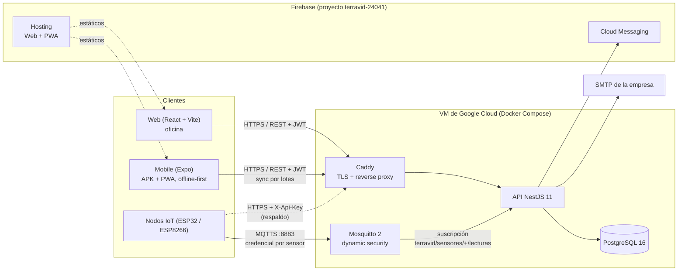

# TerraVid — Arquitectura del sistema

ERP agrícola para la trazabilidad de una finca vitivinícola, desde la
plantación hasta la vendimia. Este documento describe **el sistema tal como
está construido** (octubre de 2026). El diseño inicial de la Etapa 6 —con
Express, Redis/BullMQ, Nginx/PM2 y un entorno de staging— quedó superado; las
razones de cada cambio están en [`DECISIONS.md`](DECISIONS.md) y la versión
anterior de este archivo, en el historial de git.

---

## 1. Componentes

| Componente | Repositorio | Tecnología | Despliegue |
|---|---|---|---|
| API | Backend | NestJS 11, TypeORM, PostgreSQL 16 | Imagen Docker en Artifact Registry; la VM la toma sola (D-019) |
| Broker MQTT | Backend (`deploy/mosquitto`) | Eclipse Mosquitto 2 + dynamic security | Mismo compose, profile `mqtt` (D-026) |
| Web | Web | React 19, Vite, TanStack Query, shadcn/ui | Firebase Hosting |
| Mobile | Mobile | Expo SDK 52, React Native, SQLite (expo-sqlite / sql.js) | APK por EAS Build (M-012) y PWA en Firebase Hosting (M-014) |
| Nodos IoT | IoTSensor | ESP32 o ESP8266 (NodeMCU), DHT22/DHT11 | Firmware; contrato en [`IOT-MQTT.md`](IOT-MQTT.md) |

---

## 2. Flujos principales

### 2.1. Autenticación y permisos

- Login con email y contraseña: access token JWT corto (15 min por defecto) y
  refresh token opaco rotativo (7 días por defecto). Las duraciones las
  configura cada empresa (D-023).
- La respuesta trae `user.permisos`, la lista de capacidades del rol definida en
  `src/common/permisos/permisos.ts`. Web y Mobile deciden con ella qué mostrar;
  la autoridad es el `RolesGuard` (D-024).
- Roles: Propietario, Agrónomo, Capataz y Auditor dentro de cada empresa, y el
  **Administrador de plataforma**, que da de alta empresas (D-025).

### 2.2. Registro en campo (offline-first)

1. El capataz registra labores y pesajes en la app; se guardan en SQLite local
   con un `local_uuid` y, si hay GPS, la ubicación (M-009).
2. Al haber señal, la app los envía en lotes de 10 a `/registro-labor/sync` y
   `/pesajes-vendimia/sync`. El backend es idempotente por `local_uuid`.
3. Lo que el backend rechaza queda pendiente con el motivo y se reintenta solo
   (M-003).

### 2.3. Telemetría

1. Cada sensor publica por MQTTS en `terravid/sensores/{codigo}/lecturas` con su
   propia credencial; el broker solo le permite su tópico (D-026).
2. La API, suscripta al broker, valida el rango físico, guarda la lectura y
   evalúa los umbrales fuera del camino de la ingesta (EventEmitter2).
3. Un umbral superado genera una alerta y una notificación push (FCM).
4. Un cron nocturno consolida las lecturas viejas en promedios horarios.

### 2.4. Vendimia y costos

Pesajes por cuadrilla → remito en borrador → aprobación → liquidación de bodega.
El costo de cada labor e insumo se congela con la vigencia del día en que se
sincroniza. El avance de cosecha se compara con las metas por cuartel y campaña
(D-027).

---

## 3. Decisiones de arquitectura que cambiaron el diseño original

| Diseño original | Lo que se construyó | Decisión |
|---|---|---|
| Express | NestJS 11 + TypeORM | D-001, D-022 |
| Redis + BullMQ para trabajos diferidos | EventEmitter2 y `@nestjs/schedule` en proceso | D-g (plan de mejoras) |
| JWT de 8 h en cookie `httpOnly` | Access token corto + refresh rotativo, por header | D-023 |
| Nginx + PM2 | Caddy + Docker Compose en una VM | D-018, D-019 |
| MQTT con usuario único | Mosquitto con una credencial por sensor | D-026 |
| Entorno de staging | Producción en la VM; Cloud Run cuando el sistema esté estable | D-018 |
| Una empresa | Multi-empresa con alta por el Administrador de plataforma | D-011, D-025 |

**Cuando haga falta escalar a más de una instancia de la API:** los cron
in-process correrían en cada instancia y la suscripción MQTT recibiría cada
lectura una vez por instancia. Ahí sí conviene una cola con lock distribuido
(Redis + BullMQ) y suscripciones compartidas de MQTT 5 (`$share/...`).

---

## 4. Entornos

| Entorno | Qué corre | Base de datos |
|---|---|---|
| **Desarrollo** | `npm run start:dev`; `docker compose up -d db mqtt` para la base y el broker | PostgreSQL local en Docker |
| **CI** (GitHub Actions) | tsc, eslint, unit, e2e contra una base efímera, cobertura combinada ≥ 70 % (D-028), smoke | PostgreSQL de servicio del job |
| **Producción** | VM `e2-micro` de Google Cloud: `deploy/docker-compose.prod.yml` (db, api, caddy, mqtt) | PostgreSQL en el mismo compose, backup diario a Cloud Storage |

Dónde vive cada cosa en producción (D-029):

| Qué | Dónde | URL |
|---|---|---|
| API y broker MQTT | VM `terravid` (proyecto de GCP `terravid`, e2-micro, us-central1-a) | `terravid-api.duckdns.org` |
| Web | Firebase Hosting, proyecto `terravid-24041` | `terravid-24041.web.app` |
| PWA de Mobile | Firebase Hosting, sitio `terravid-mobile` del mismo proyecto | `terravid-mobile.web.app` |
| APK | EAS Build, proyecto `@sergixfarias/terravid-mobile` | enlace de cada build |
| Notificaciones push | Firebase Cloud Messaging, proyecto `terravid-24041` | — |

La copia anterior de la PWA en `terravid-mobile.duckdns.org` (Caddy en la VM)
ya no se actualiza. El dominio definitivo será `terravid.com`. El
procedimiento de despliegue está en [`DESPLIEGUE.md`](DESPLIEGUE.md).

Los dos proyectos de Google (`terravid` y `terravid-24041`) tienen como Owner
a las mismas dos cuentas, así que cualquiera de las dos administra la VM y
Firebase (D-031).
