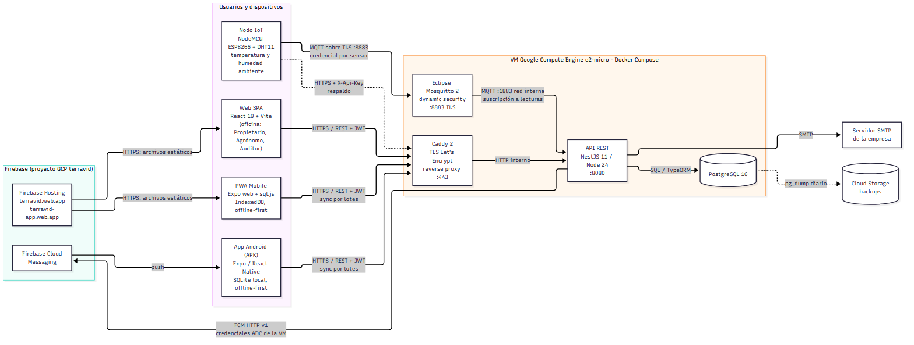
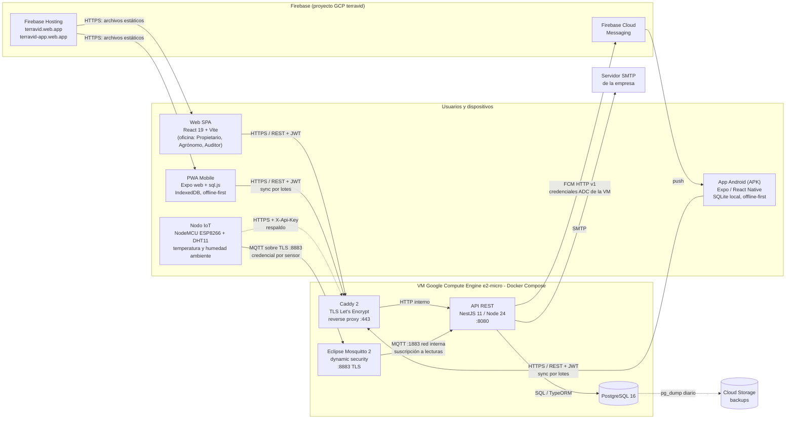
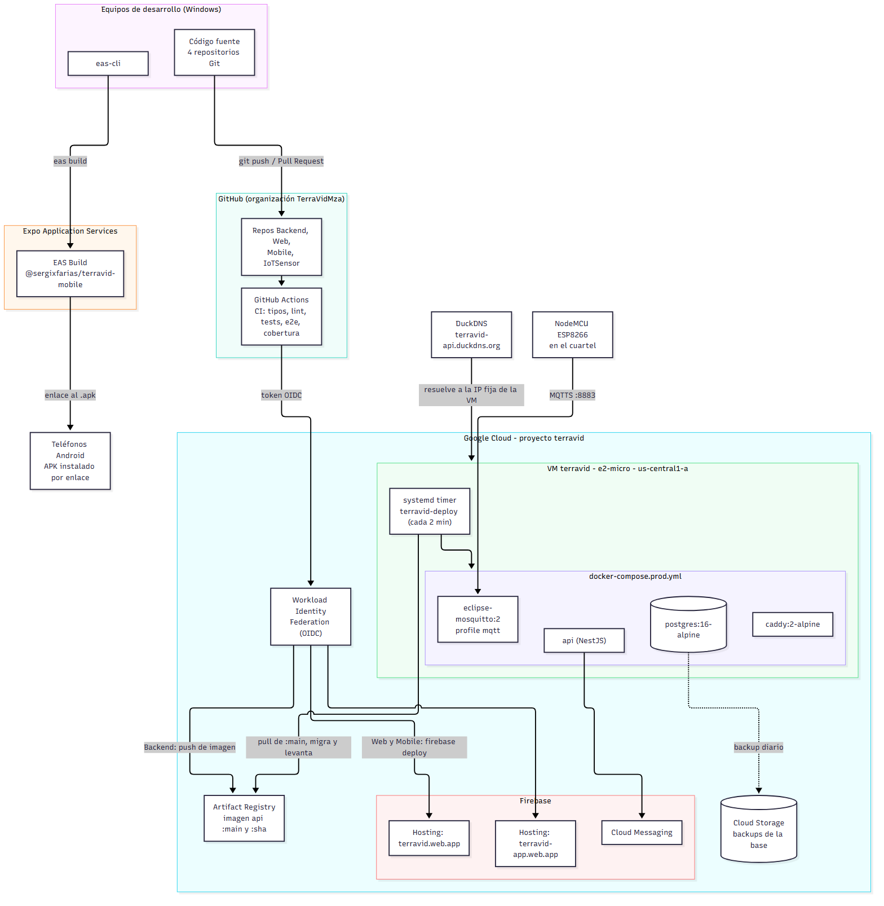
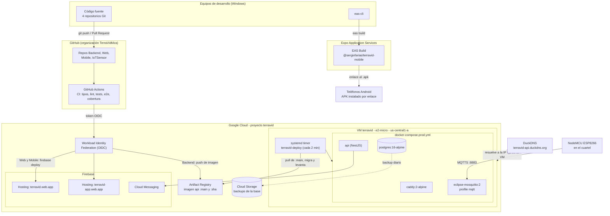

# TerraVid — Arquitectura del sistema

**Proyecto Final — Etapa 6 · UTN Facultad Regional Mendoza**
**Integrantes:** Paula Alvarado y Sergio Farias
**Fecha:** octubre de 2026

---

## 1. Introducción y tipo de aplicativo

TerraVid es un ERP agrícola para la trazabilidad de una finca vitivinícola,
desde la plantación hasta la vendimia. El sistema es un **aplicativo híbrido
web + mobile** complementado con telemetría IoT:

| Cliente | Usuarios | Características |
|---|---|---|
| **Web SPA** (navegador) | Propietario, Agrónomo, Auditor, Administrador de plataforma | Gestión de oficina: maestros, campañas, costos, remitos, reportes, telemetría y auditoría. |
| **App móvil** (APK Android y PWA instalable) | Capataz y quien tenga el permiso | **Offline-first:** registra labores y pesajes de vendimia sin señal en una base SQLite local y los sincroniza al recuperar conexión. Recibe notificaciones push (APK). |
| **Nodo IoT** (NodeMCU ESP8266 + DHT11) | — | Mide temperatura y humedad ambiente en el cuartel y publica las lecturas por MQTT sobre TLS. |

Los tres clientes consumen un único **backend NestJS** que expone una API REST,
persiste en **PostgreSQL** y recibe la telemetría a través de un broker
**Mosquitto**. El backend corre en una VM de Google Cloud; los clientes web se
sirven como archivos estáticos desde Firebase Hosting.

La versión técnica de este documento, mantenida junto al código, es
[`docs/ARCHITECTURE.md`](../ARCHITECTURE.md).

---

## 2. Diagramas

### 2.1. Diagrama de arquitectura (componentes y comunicación)



Fuente del diagrama (Mermaid; la imagen se genera desde
[`img/arquitectura.mmd`](img/arquitectura.mmd) con `@mermaid-js/mermaid-cli`):



Referencias del diagrama:

- **Flecha continua:** canal principal. **Flecha punteada:** canal de respaldo
  o tarea programada.
- Solo Caddy (80/443) y Mosquitto (8883) están expuestos a internet. La API
  (8080), PostgreSQL (5432, solo loopback) y el puerto MQTT sin cifrar (1883)
  quedan en la red interna de Docker.

### 2.2. Diagrama de despliegue (dónde vive cada componente)





---

## 3. Tecnologías por componente

Versiones tomadas de `package.json`, `platformio.ini`, `Dockerfile` y los
archivos de Compose de cada repositorio (rama `develop` / `main`, octubre de 2026).

| Componente | Lenguaje | Framework y librerías clave | Almacenamiento | Versión |
|---|---|---|---|---|
| **Backend (API REST)** | TypeScript 5.9 sobre Node.js 24 | NestJS 11.2, TypeORM 1.1 (driver `pg` 8.23), Passport + `@nestjs/jwt` (JWT), bcrypt 6, class-validator, `@nestjs/schedule` (cron), `@nestjs/event-emitter`, `@nestjs/throttler`, Helmet, Swagger/OpenAPI, cliente `mqtt` 5.16, `firebase-admin` 14.5, Nodemailer 10 | PostgreSQL 16 | `terravid-backend` 0.0.1 |
| **Base de datos** | SQL | Esquema gobernado por migraciones TypeORM; extensión `btree_gist`; dos roles (migración / aplicación acotada) | Producción: `postgres:16-alpine`. Desarrollo: `postgis/postgis:16-3.4` | PostgreSQL 16 |
| **Broker MQTT** | — (configuración) | Eclipse Mosquitto 2 con plugin *dynamic security* (credencial y ACL por sensor) | Volumen `mqtt_data` | `eclipse-mosquitto:2` |
| **Proxy inverso** | — (Caddyfile) | Caddy 2: TLS automático con Let's Encrypt, HTTP/2 y HTTP/3, cabeceras de seguridad | Volumen `caddy_data` (certificados) | `caddy:2-alpine` |
| **Frontend Web** | TypeScript 6.0 | React 19.2, Vite 8.2, React Router 7, TanStack Query 5, Axios, Zod 4, React Hook Form, Tailwind CSS 4 + shadcn/ui, Leaflet / React-Leaflet (mapas), Recharts 3 (gráficos). Pruebas: Vitest 4, MSW 2, Playwright 1.63 | `localStorage` (sesión) | `terravid-web` 0.0.0 |
| **App Mobile (APK + PWA)** | TypeScript 5.3 | Expo SDK 52, React Native 0.76, React 18.3, Expo Router 4, Zustand 5, Axios, Zod 3, `expo-sqlite`, `sql.js` (PWA), `expo-notifications`, `expo-location`, `expo-local-authentication`, `expo-secure-store`, `react-native-web`. Pruebas: Jest 29, Maestro (E2E manual) | SQLite local (nativo en Android; sql.js/WebAssembly persistido en IndexedDB en la PWA) | `terravid-mobile` 1.0.0, paquete `com.terravidmza.mobile` |
| **Firmware IoT** | C++ | Arduino Framework sobre PlatformIO (`espressif8266`, placa `nodemcuv2`), Adafruit DHT sensor library 1.4, ArduinoJson 7, PubSubClient 2.8 (MQTT), BearSSL con raíces de Let's Encrypt | — (envía cada 5 min por defecto) | Entorno `nodemcuv2` |
| **Simulador IoT** | Python 3 | `paho-mqtt` 2, `requests`, `python-dotenv` | — | `simulador/simulador.py` |
| **Servicios externos** | — | Firebase Hosting, Firebase Cloud Messaging, Google Artifact Registry, Cloud Storage, EAS Build, DuckDNS, servidor SMTP | — | — |

> **Alcance del nodo IoT para la entrega:** el firmware compila también para
> ESP32 y soporta DHT22 y un sensor capacitivo de humedad de suelo, pero el nodo
> que se presenta es una **NodeMCU ESP8266 con DHT11** que publica únicamente
> temperatura y humedad ambiente (`TIPO_DHT DHT11` y `SENSOR_SUELO_CONECTADO 0`
> en `include/config.h`).

---

## 4. Comunicación entre componentes

### 4.1. Autenticación: JWT con refresh token rotativo

1. El usuario inicia sesión con email y contraseña (`POST /api/auth/login`).
   La contraseña se verifica con bcrypt.
2. El backend devuelve un **access token JWT de corta duración** (15 minutos por
   defecto) y un **refresh token opaco** (7 días por defecto); cada empresa
   puede configurar ambas duraciones ([D-023](../DECISIONS.md)).
3. Cada request lleva `Authorization: Bearer <access token>`. Un `JwtAuthGuard`
   global protege todas las rutas salvo las declaradas públicas, y el
   `RolesGuard` controla los permisos por rol.
4. El cliente renueva el access token en segundo plano con
   `POST /api/auth/refresh`. El refresh token **rota en cada uso**: un segundo
   uso del mismo token se trata como robo y revoca la sesión (con 30 s de gracia
   para pestañas concurrentes). Web: [W-024](https://github.com/TerraVidMza/Web/blob/main/docs/DECISIONS.md);
   Mobile, donde la sesión debe sobrevivir al trabajo sin señal:
   [M-004](https://github.com/TerraVidMza/Mobile/blob/main/docs/DECISIONS.md).
5. La respuesta del login incluye `user.permisos`; Web y Mobile lo usan solo
   para mostrar u ocultar opciones. La autoridad es siempre el backend
   ([D-024](../DECISIONS.md)).

Los tokens se guardan en `localStorage` en la Web y en `expo-secure-store` en
la app Android; la app admite desbloqueo biométrico local de la sesión guardada
(M-007).

### 4.2. Sincronización offline de la app móvil

1. El capataz registra labores y pesajes en el campo. Cada registro se guarda
   primero en **SQLite local** con un `local_uuid` (UUID v4) y, si hay GPS, su
   ubicación.
2. Al recuperar señal (y también al abrir la app, al iniciar sesión, al guardar
   un registro o a pedido del usuario) la app envía los pendientes en **lotes de
   hasta 10 registros** a `POST /api/registro-labor/sync` y
   `POST /api/pesajes-vendimia/sync`.
3. El backend es **idempotente por `local_uuid`**: un registro repetido no
   duplica filas.
4. Lo que el backend rechaza queda pendiente con su motivo y se reintenta
   automáticamente (30 s, 60 s y 120 s con jitter) ([M-003](https://github.com/TerraVidMza/Mobile/blob/main/docs/DECISIONS.md)).

En la PWA la base es la misma SQLite compilada a WebAssembly (sql.js) y
persistida en IndexedDB ([M-001](https://github.com/TerraVidMza/Mobile/blob/main/docs/DECISIONS.md)),
y un service worker permite abrirla sin conexión (M-011).

### 4.3. Ingesta de telemetría: MQTT con HTTP de respaldo

1. El nodo se conecta a `mqtts://terravid-api.duckdns.org:8883`, validando el
   certificado de Let's Encrypt, con una **credencial propia por sensor**
   (usuario = código del sensor) generada desde la Web.
2. Publica con QoS 1 en `terravid/sensores/{codigo}/lecturas` un JSON
   `{ valor, unidad, sensorTimestamp }`. El broker solo le permite publicar en
   su propio tópico.
3. La API está suscripta al broker por la red interna (1883), valida el rango
   físico, guarda la lectura (o la envía a `lecturas_anomalas`) y evalúa los
   umbrales de forma asíncrona con EventEmitter2.
4. Las credenciales se administran desde la API enviando comandos al plugin
   *dynamic security* de Mosquitto (`$CONTROL/dynamic-security/v1`), sin
   reiniciar el broker ([D-026](../DECISIONS.md)).
5. **Respaldo:** si el broker no está configurado o no responde, el firmware
   envía la lectura por `POST /api/lecturas-iot` con cabecera `X-Api-Key`.
6. Un cron nocturno consolida las lecturas antiguas en promedios horarios.

El contrato completo está en [`docs/IOT-MQTT.md`](../IOT-MQTT.md).

### 4.4. Notificaciones push y correo

- Cuando una lectura supera un umbral se genera una alerta y la API envía una
  **notificación push** con `firebase-admin` a Firebase Cloud Messaging, que la
  entrega a la app Android. El APK registra su token de dispositivo en
  `POST /api/notificaciones/device-token` al iniciar sesión.
- La API se autentica ante FCM **sin claves**: usa las credenciales por defecto
  de la aplicación (ADC) de la cuenta de servicio de la VM, obtenidas del
  servidor de metadatos ([D-033](../DECISIONS.md), [D-015](../DECISIONS.md)).
- El correo saliente (recuperación de contraseña, avisos de alertas y
  reportes) se envía por **SMTP** con Nodemailer; el servidor SMTP lo configura
  cada empresa desde la Web, con las variables de entorno de la VM como respaldo.

---

## 5. Entornos

| | **Desarrollo** | **CI** | **Producción** |
|---|---|---|---|
| **Dónde corre** | PC de cada integrante (Windows) | GitHub Actions (`ubuntu-latest`) | Google Cloud, proyecto `terravid` |
| **Backend** | `npm run start:dev` en `http://localhost:3000/api` | Compilación, lint, tests unitarios, e2e y smoke contra la API levantada | VM `terravid` (e2-micro, us-central1-a), Docker Compose (`deploy/docker-compose.prod.yml`): `https://terravid-api.duckdns.org/api` |
| **Base de datos** | `docker compose up -d db` — PostgreSQL 16 (imagen PostGIS) en `localhost:5432` | PostgreSQL de servicio del job, efímero; se aplican migraciones y seed | PostgreSQL 16 en el mismo Compose (solo loopback), backup diario a Cloud Storage |
| **Broker MQTT** | `docker compose up -d mqtt` — Mosquitto en `mqtt://localhost:1883` (opcional) | — | Mosquitto en `mqtts://terravid-api.duckdns.org:8883` |
| **Web** | `npm run dev` (Vite) en `http://localhost:5173` | Workflow `ci.yml`: tipos, lint, tests con cobertura, build | Firebase Hosting: `https://terravid.web.app` |
| **Mobile** | `npm start` (Metro, puerto 8081); emulador Android con la API en `http://10.0.2.2:3000/api`; `npm run web` para la PWA | Workflow `deploy-mobile.yml`: validación, tests y build web | PWA: `https://terravid-app.web.app`. APK: EAS Build (perfil `production`), distribuido por enlace, sin tienda |
| **IoT** | Simulador Python (`simulador.py --transport mqtt` o `http`) contra el entorno local o productivo | — | NodeMCU ESP8266 + DHT11 publicando al broker productivo |
| **Push / correo** | `PUSH_TRANSPORT=log` y `MAIL_TRANSPORT=log` (se escriben en consola) | Transportes `log` | FCM con ADC de la VM; SMTP |

### Promoción del código

El equipo trabaja con Gitflow en los cuatro repositorios (ver `CONTRIBUTING.md`
de cada uno):

```
feature/* o fix/*  ──PR──▶  develop  ──PR──▶  main  ──▶  despliegue automático
                       (CI obligatorio)  (CI obligatorio)
hotfix/*  ──PR──▶  main  (y back-merge a develop)
```

1. Cada funcionalidad se desarrolla en `feature/<ID-Jira>-<descripción>` a
   partir de `develop` y se integra por Pull Request.
2. Cada Pull Request y cada push a `develop` o `main` ejecutan el CI; debe
   pasar para poder mergear. En el backend incluye e2e contra PostgreSQL real y
   una **cobertura combinada mínima del 70 %** ([D-028](../DECISIONS.md)).
3. El merge de `develop` a `main` dispara el despliegue:
   - **Backend:** GitHub Actions construye la imagen Docker y la publica en
     Artifact Registry con las etiquetas `main` y el SHA corto. En la VM, un
     timer de systemd revisa cada 2 minutos si `main` cambió; si cambió, baja
     la imagen, **aplica las migraciones en un contenedor efímero**, reaplica
     los privilegios del rol de aplicación, levanta la API y verifica que
     responda. Si no responde en 90 s, vuelve a la imagen anterior
     ([D-019](../DECISIONS.md)).
   - **Web y PWA:** el workflow publica en Firebase Hosting con `firebase-tools`
     ([W-030](https://github.com/TerraVidMza/Web/blob/main/docs/DECISIONS.md),
     [M-014](https://github.com/TerraVidMza/Mobile/blob/main/docs/DECISIONS.md)).
   - **APK:** se compila bajo demanda con `eas build --platform android
     --profile production` y se comparte el enlace al `.apk` ([M-012](https://github.com/TerraVidMza/Mobile/blob/main/docs/DECISIONS.md)).
4. GitHub se autentica en Google Cloud con **Workload Identity Federation**
   (OIDC): no hay claves JSON de cuentas de servicio guardadas como secretos.

---

## 6. Decisiones de arquitectura clave

- **NestJS 11 + TypeORM en lugar de Express** — estructura modular, inyección
  de dependencias y guards declarativos para un dominio con muchos módulos
  ([D-001](../DECISIONS.md), [D-022](../DECISIONS.md)).
- **El esquema lo gobiernan las migraciones, y la aplicación usa un rol de base
  de datos acotado** distinto del de migración ([D-007](../DECISIONS.md),
  [D-017](../DECISIONS.md)).
- **Sesiones con access token corto y refresh token rotativo**, con duración
  configurable por empresa ([D-023](../DECISIONS.md),
  [W-024](https://github.com/TerraVidMza/Web/blob/main/docs/DECISIONS.md),
  [M-004](https://github.com/TerraVidMza/Mobile/blob/main/docs/DECISIONS.md)).
- **Offline-first con SQLite real en el dispositivo y en la PWA**,
  sincronización idempotente por `local_uuid` y reintento automático
  ([M-001](https://github.com/TerraVidMza/Mobile/blob/main/docs/DECISIONS.md),
  [M-003](https://github.com/TerraVidMza/Mobile/blob/main/docs/DECISIONS.md)).
- **Telemetría por MQTT/TLS con una credencial por sensor** administrada por la
  API, y HTTP con API key como respaldo ([D-026](../DECISIONS.md)).
- **Backend, base y broker en una VM e2-micro con Docker Compose; estáticos en
  Firebase Hosting.** El broker necesita TCP directo en el 8883 y la API una
  suscripción permanente, que no encajan con servicios que se apagan sin
  tráfico; la e2-micro entra en la capa gratuita ([D-029](../DECISIONS.md)).
  Todo en un único proyecto de Google Cloud, `terravid` ([D-033](../DECISIONS.md)).
- **Despliegue continuo por tirón (*pull*):** el CI solo publica la imagen; la
  VM la busca, migra y verifica. Las credenciales de la base nunca salen de la
  VM y la autenticación de GitHub es sin claves ([D-019](../DECISIONS.md)).
- **Distribución de la app por APK y PWA, sin tiendas**
  ([M-012](https://github.com/TerraVidMza/Mobile/blob/main/docs/DECISIONS.md),
  [M-014](https://github.com/TerraVidMza/Mobile/blob/main/docs/DECISIONS.md)).
