# Análisis estático del código — TerraVid

**Proyecto Final · Etapa 6 — Desarrollo e Implementación**
Integrantes: Paula Alvarado · Sergio Farias
Fecha: 13/10/2026 · Repositorios analizados: `TerraVidMza/Backend` (main `6f5a698`), `TerraVidMza/Web` (main `76a75c9`), `TerraVidMza/Mobile` (main `b2ec07d`)

---

## 1. Herramientas elegidas y por qué

Todo el sistema está escrito en **TypeScript**: el backend en NestJS, la Web en React con Vite y la app móvil en React Native con Expo. Por eso se eligieron analizadores del ecosistema JavaScript/TypeScript, en dos niveles:

| Nivel | Herramienta | Dónde | Por qué |
|---|---|---|---|
| **Linter en cada commit** (definido en la Etapa 2, gestión de la configuración) | **ESLint 9** + `typescript-eslint` (reglas *type-checked*) + Prettier | Backend | Es el estándar de facto para TypeScript y NestJS lo trae integrado. Las reglas *type-checked* usan el compilador para detectar promesas sin `await`, `any` implícitos y llamadas inseguras, que son los errores que más cuestan en un backend. Corre en el hook de husky antes de cada commit y en el CI. |
| | **oxlint** | Web | Linter compatible con las reglas de ESLint, escrito en Rust y unas 50 veces más rápido. Se eligió en la Web porque corre en cada guardado y en el CI sin demorar el ciclo. Usa los plugins `react`, `jsx-a11y`, `typescript` y `vitest`. |
| | **Compilador TypeScript** (`tsc --noEmit`, modo `strict`) | Los tres | El chequeo de tipos estricto es en sí un análisis estático: ningún repositorio compila con errores de tipos. |
| | **`npm audit`** | Los tres | Análisis de las dependencias contra la base de vulnerabilidades conocidas (CVE/GHSA). |
| **Plataforma de calidad** | **SonarQube Cloud (SonarCloud)** | Los tres | Suma lo que un linter no mira: *security hotspots*, duplicación, deuda técnica estimada en tiempo, *code smells* por complejidad y una **Quality Gate** visible por rama y por PR. Es gratuita para repositorios públicos, no requiere servidor propio y analiza TypeScript sin configuración adicional. Es la única herramienta que cubre Mobile, que no tenía linter. |

---

## 2. Configuración entregada (archivos comentados)

| Archivo | Repositorio | Qué configura |
|---|---|---|
| [`eslint.config.mjs`](../../eslint.config.mjs) | Backend | Reglas recomendadas y *type-checked* de `typescript-eslint` y Prettier. Endurece `no-explicit-any`, `no-floating-promises` y `no-unsafe-argument` a error. Excepciones documentadas para tests y JS plano. Ignora `dist/` y `coverage*/`. |
| [`.sonarcloud.properties`](../../.sonarcloud.properties) | Backend | Fuentes (`src`), tests (`*.spec.ts`, `test/`), exclusión de migraciones generadas, codificación. |
| `.oxlintrc.json` | Web | Plugins `react`, `typescript`, `oxc`, `jsx-a11y`, `vitest`. Categoría *correctness* como error. `rules-of-hooks` como error; `exhaustive-deps` y `only-export-components` como advertencia; excepción para los componentes generados por shadcn/ui. |
| `.sonarcloud.properties` | Web | Fuentes `src`, tests de Vitest y Playwright, exclusión de duplicación en `src/components/ui` (código copiado de shadcn/ui). |
| `.sonarcloud.properties` | Mobile | Fuentes `src`, tests de Jest, mocks y flujos de Maestro. |

Extracto comentado de la configuración de ESLint del backend, con los cambios de esta etapa:

```js
export default tseslint.config(
  {
    // La config plana de ESLint no lee .gitignore: sin estas entradas, despues
    // de un `nest build` o de `npm run test:cov` analiza el JS compilado y los
    // reportes de cobertura, y la corrida pasa de 0 a miles de errores ajenos.
    ignores: ['eslint.config.mjs', 'dist/**', 'coverage*/**'],
  },
  eslint.configs.recommended,
  ...tseslint.configs.recommendedTypeChecked,
  eslintPluginPrettierRecommended,
  {
    languageOptions: {
      parserOptions: {
        // Los .js/.mjs sueltos (configuracion de jest, smoke test) no entran en
        // tsconfig.json porque no se compilan. Sin esta lista ESLint no los
        // encuentra en el proyecto y aborta el archivo con un "Parsing error",
        // que contaba como error y ademas dejaba esos archivos sin analizar.
        projectService: {
          allowDefaultProject: ['jest.cobertura.config.js', 'test/smoke.mjs'],
        },
        tsconfigRootDir: import.meta.dirname,
      },
    },
  },
  {
    rules: {
      // Se suben a error porque el codigo hoy no las viola (...)
      '@typescript-eslint/no-explicit-any': 'error',
      '@typescript-eslint/no-floating-promises': 'error',
      '@typescript-eslint/no-unsafe-argument': 'error',
      'prettier/prettier': ['error', { endOfLine: 'auto' }],
    },
  },
  {
    // JavaScript plano no tiene tipos: las reglas "unsafe-*" lo marcan todo
    // como `any`. Se analizan con las reglas comunes, sin las que usan tipos.
    files: ['**/*.js', '**/*.mjs'],
    ...tseslint.configs.disableTypeChecked,
  },
  // (+ excepción documentada para tests de integración con SQL crudo)
);
```

Extracto de `.sonarcloud.properties` (Backend):

```properties
# Codigo de produccion: solo src/. dist/ y coverage/ son artefactos generados.
sonar.sources=src
# Los *.spec.ts viven junto al codigo; se marcan como tests para que sus
# reglas (y la duplicacion entre fixtures) no cuenten como deuda del producto.
sonar.tests=src,test
sonar.test.inclusions=**/*.spec.ts,test/**/*
sonar.exclusions=**/*.spec.ts,src/database/migrations/**
# Las migraciones de TypeORM se generan y no se editan: duplicacion esperada.
sonar.cpd.exclusions=src/database/migrations/**,src/database/seeds/**
```

---

## 3. Ejecución sobre los repositorios

### 3.1 Resultados por repositorio

| Repositorio | Herramienta | Errores | Advertencias | Observación |
|---|---|---:|---:|---|
| Backend | ESLint (primera corrida) | **2** | 0 | Dos archivos no se analizaban: *Parsing error*. |
| Backend | ESLint (última corrida) | **0** | **0** | Ver §4. |
| Backend | `tsc --noEmit` | 0 | — | |
| Web | oxlint | **0** | **6** | Las 6 son `react(only-export-components)`: archivos que exportan un componente y además una constante o hook. Solo afectan el *fast refresh* en desarrollo, no el funcionamiento. |
| Web | `tsc --noEmit` | 0 | — | |
| Mobile | `tsc --noEmit` | 0 | — | No tiene linter propio: lo cubre SonarCloud. |
| Backend | `npm audit` | 1 crítica · 1 alta | 23 moderadas | Todas transitivas (`handlebars` vía Jest). |
| Web | `npm audit` | 1 crítica · 13 altas | 4 moderadas | `proxy-addr` (transitiva), `axios` y `shadcn` (directas). |
| Mobile | `npm audit` | 3 críticas · 63 altas | 20 moderadas | Casi todas vienen del árbol de Expo SDK y React Native. |

### 3.2 Capturas

**ESLint, Backend: primera corrida (configuración original)**
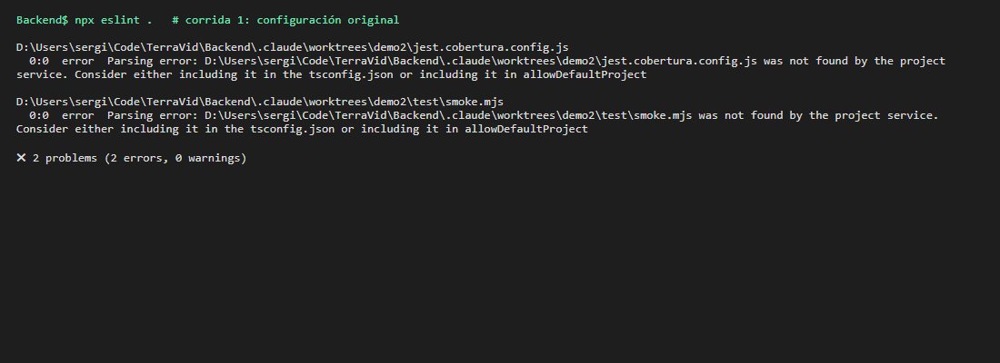

**ESLint, Backend: segunda corrida (configuración corregida; aparecen los problemas que antes quedaban ocultos)**
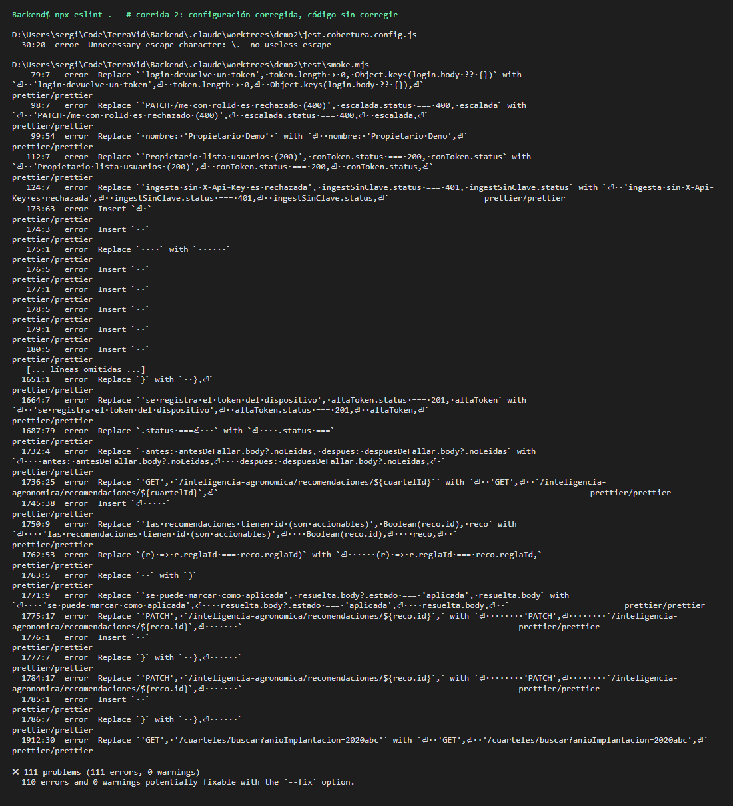

**ESLint, Backend: última corrida (después de las correcciones)**
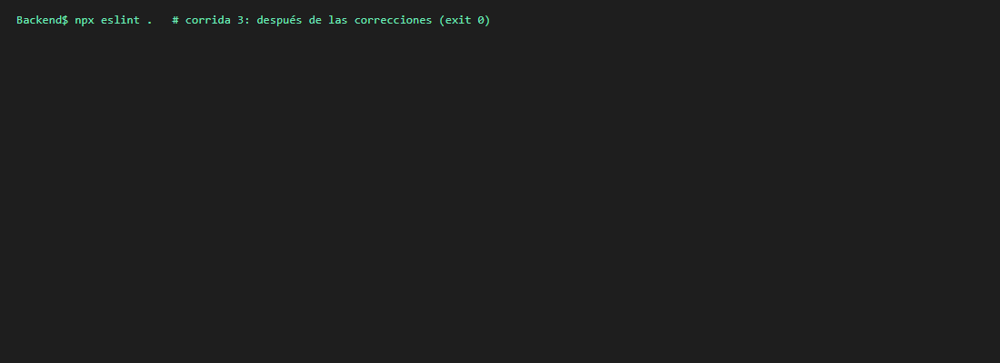

**oxlint, Web**
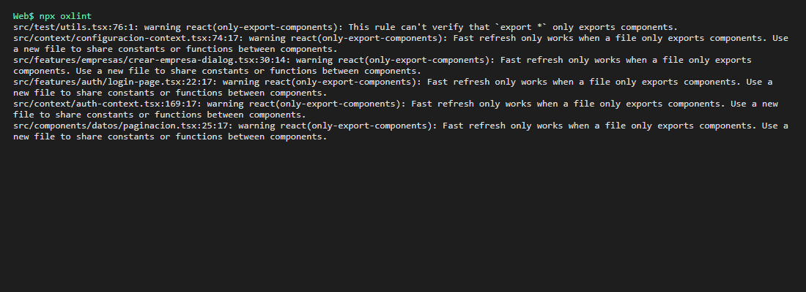

**TypeScript estricto, Mobile**
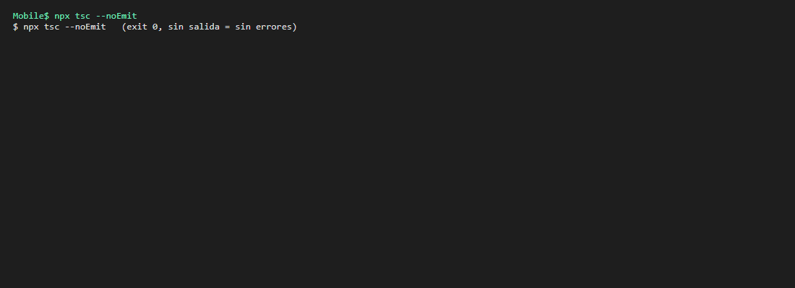

**`npm audit`**
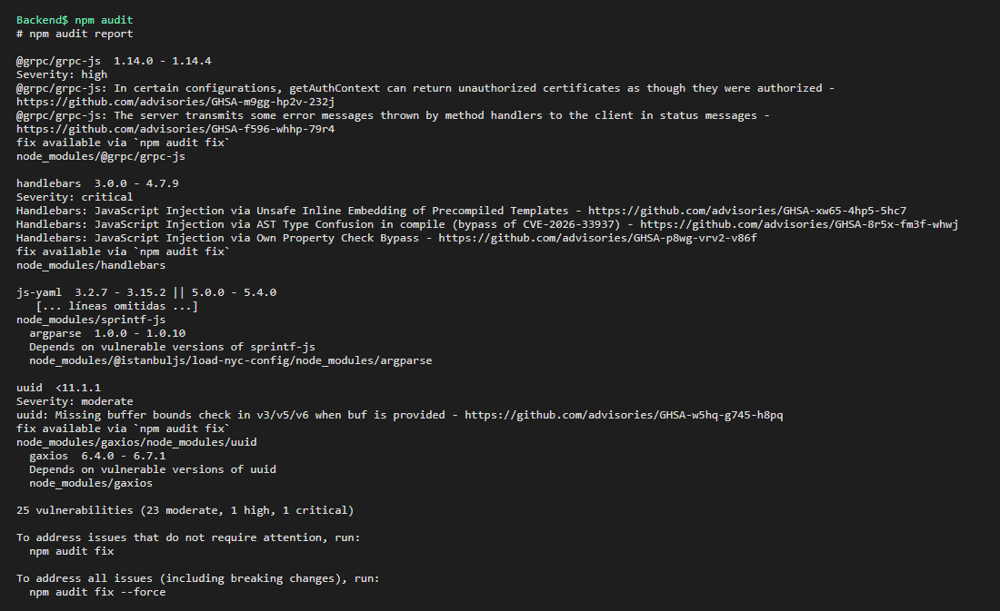
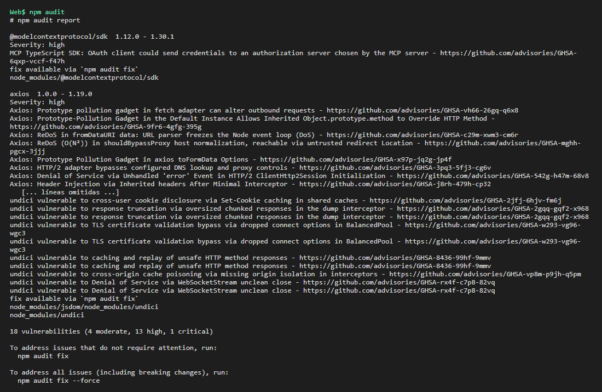
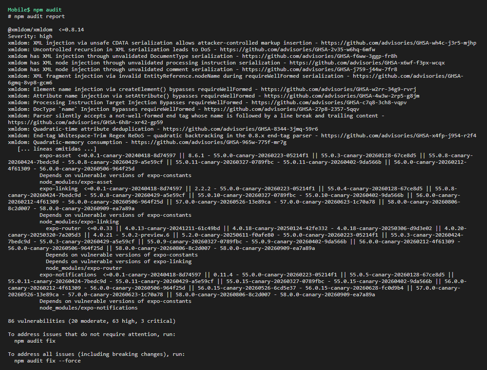

### 3.3 SonarCloud

Los tres repositorios se importan en SonarCloud (organización `TerraVidMza`) en modo *Automatic Analysis*, que lee el `.sonarcloud.properties` de cada repositorio. Desde ese momento SonarCloud analiza `main` y cada PR en cada push y aplica la Quality Gate *Sonar way*. Requiere que los repositorios sean públicos: antes de publicarlos se revisó el historial completo con **gitleaks**, sin secretos reales (los 7 hallazgos eran contraseñas de ejemplo en tests y marcadores en la documentación).

Paneles públicos:
- https://sonarcloud.io/summary/overall?id=TerraVidMza_Backend
- https://sonarcloud.io/summary/overall?id=TerraVidMza_Web
- https://sonarcloud.io/summary/overall?id=TerraVidMza_Mobile

La organización se llama `terravid`.

**Primer análisis (13/10/2026, `main`):**

| Proyecto | Líneas | Security | Reliability | Maintainability | Duplicación | Quality Gate |
|---|---:|---|---|---|---:|---|
| Backend | 14k | **E** (2 issues) | A (35) | A (91) | 1,0 % | ✅ Passed |
| Web | 16k | A (0) | **D** (6) | A (108) | 0,9 % | ✅ Passed |
| Mobile | 6,4k | C (2) | C (50) | A (86) | 5,7 % | ✅ Passed |


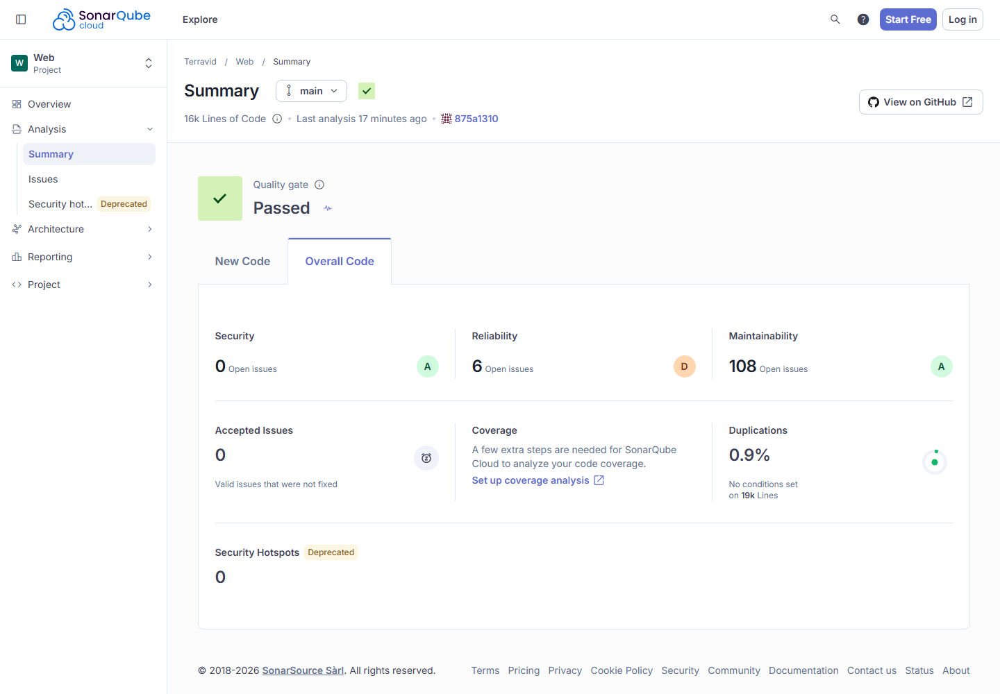
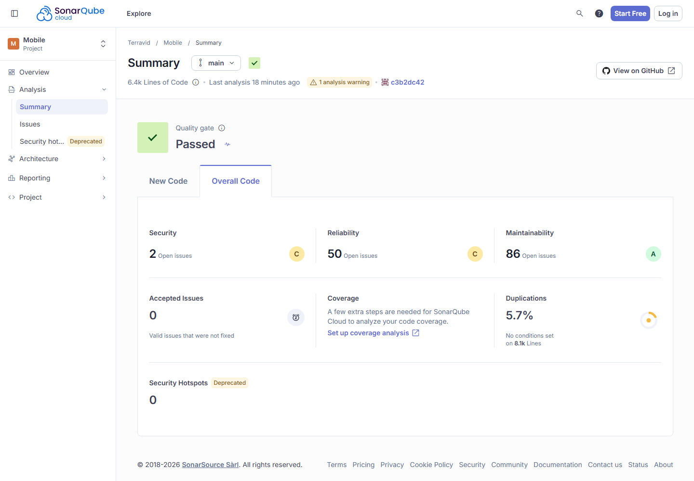

Qué hay detrás de cada calificación baja:

- **Backend, Security E:** hay un BLOCKER, `secrets:S8215`, porque `auth.service.ts` tiene un hash bcrypt fijo, `HASH_DUMMY`. Ese hash iguala el tiempo de login cuando el email no existe. El otro hallazgo es `S2068`, la contraseña de la base de demostración.
- **Web, Reliability D:** dos bugs críticos `S2871`, ambos un `.sort()` sin comparador sobre textos.
- **Mobile, Reliability C:** 29 avisos `S9383` de promesas sin `await` ni `.catch`. Son llamadas «dispara y olvida» desde manejadores de React Native.
- **Mobile, Security C:** un aviso `S2245`, por `Math.random` en el *jitter* de reintentos. No es un uso criptográfico.
- El resto de los hallazgos están en tests y workflows: contraseñas de fixtures, actions sin SHA fijo y `--ignore-scripts`.

---

## 4. Problemas críticos corregidos: antes y después

### Problema 1: dos archivos quedaban fuera del análisis (Parsing error)

- **Hallazgo:** `jest.cobertura.config.js` y `test/smoke.mjs` no forman parte de `tsconfig.json` porque no se compilan.
  - Con `projectService: true`, ESLint no los encontraba, abortaba el archivo y reportaba un *Parsing error*.
  - Es crítico por dos razones: el linter **fallaba siempre** (exit 1, lo que en CI bloquea o se termina ignorando) y esos archivos **nunca se habían analizado**.
  - Uno de ellos, `smoke.mjs`, es la prueba de humo de 185 casos que valida cada despliegue.
- **Corrección:**
  - Se agregaron a `allowDefaultProject`.
  - Para JavaScript plano se desactivaron las reglas que dependen de tipos (`disableTypeChecked`), porque sin tipos marcarían todo como `any`.
- **Efecto:** al empezar a analizarlos aparecieron **111 problemas** que estaban ocultos.
  - 110 eran de formato: Prettier, corregidos con `eslint --fix`.
  - El restante se describe en el problema 2.

### Problema 2: expresión regular mal escapada en la configuración de cobertura

- **Hallazgo:** `no-useless-escape` en `jest.cobertura.config.js`, en la línea `transform: { '^.+\.(t|j)s$': 'ts-jest' }`.
  - Dentro de un string de JavaScript, `\.` se convierte en `.`, así que la regex que recibe Jest es `^.+.(t|j)s$`.
  - El punto acepta **cualquier carácter**, no solo un punto literal, y por eso también coincidía con nombres sin extensión que terminan en `ts` o `js`, como `assets` o `tests`.
- **Corrección:** `'^.+\\.(t|j)s$'`, con el escape doble para que la regex reciba `\.`, y un comentario explicativo.
- **Verificación:** la suite completa sigue en verde, con 31 suites y 423 tests.

### Problema 3, de configuración: el análisis dependía del estado del disco

- Después de compilar con `nest build`, la corrida pasaba de 0 a más de 17.000 errores, porque la configuración plana de ESLint **no lee `.gitignore`** y analizaba `dist/`.
- Se agregaron `dist/**` y `coverage*/**` a `ignores`. Ahora el resultado es el mismo en la máquina del desarrollador y en el CI.

### Cuadro antes y después (ESLint, Backend)

| Corrida | Configuración | Código | Errores | Advertencias | Archivos analizados |
|---|---|---|---:|---:|---:|
| 1.ª (inicial) | original | original | **2** | 0 | 288 de 290 |
| 2.ª | corregida | original | 111 | 0 | 290 de 290 |
| Última | corregida | corregido | **0** | **0** | 290 de 290 |

### Problema 4: secreto en el código del login (SonarCloud BLOCKER, Backend)

- **Hallazgo:** `HASH_DUMMY` era un hash bcrypt fijo en `auth.service.ts`. SonarCloud lo clasifica como secreto filtrado (`secrets:S8215`, BLOCKER) y por eso el backend tenía **Security E**.
- **Problema adicional:** el costo de ese hash estaba fijo en 12. Si `BCRYPT_SALT_ROUNDS` tomaba otro valor, el login con un email inexistente tardaba distinto que con uno existente, y volvía a delatar qué cuentas existen. Esa es justamente la protección que el hash buscaba dar.
- **Corrección (D-035):** se genera al arrancar con `bcrypt.hashSync(crypto.randomBytes(32), saltRounds())`. `PASSWORD_DEMO` se marcó `NOSONAR` con su justificación, porque es la clave pública de la base de demostración y producción la rechaza.

### Problema 5: orden incorrecto de textos (SonarCloud CRITICAL, Web)

- **Hallazgo:** dos `.sort()` sin comparador (`S2871`), en la comparación de campañas y en el detalle de auditoría. JavaScript ordena por código UTF-16, así que «Área» queda después de «zona».
- **Corrección (W-033):** se reemplazaron por `.sort((a, b) => a.localeCompare(b))`.

### Cuadro antes y después (SonarCloud)

| Proyecto | Indicador | Primer análisis | Después de las correcciones |
|---|---|---|---|
| Backend | Security | **E** · 1 BLOCKER + 1 MAJOR | **A** · 0 issues (`main` 722ba9a) |
| Web | Reliability | **D** · 2 CRITICAL | **A** · 0 bugs (`main` 21e842a) |
| Mobile | Reliability / Security | C / C | Sin cambios: planificado (§5) |

Las tres Quality Gates siguen aprobadas.

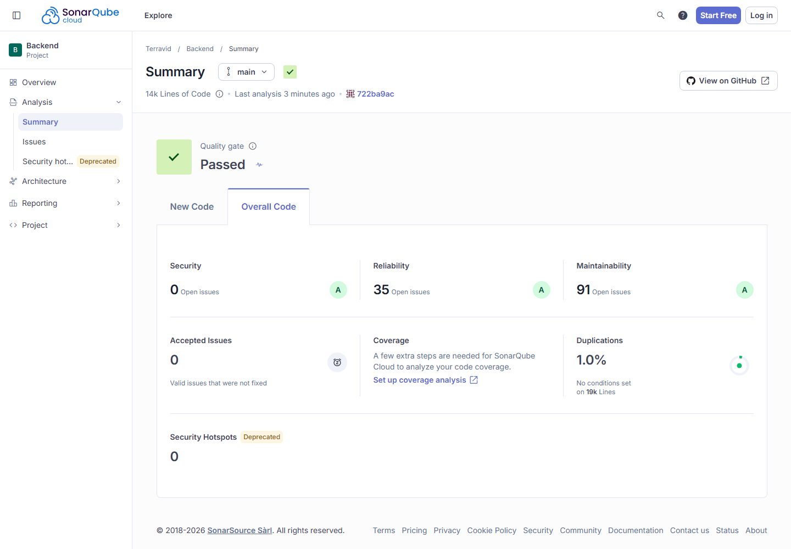
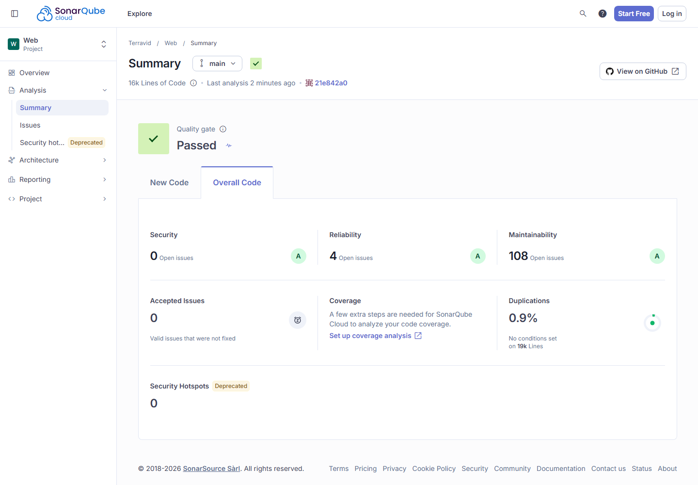

### Cuadro global (los tres repositorios)

| Repositorio | Errores (1.ª corrida) | Advertencias (1.ª) | Errores (última) | Advertencias (última) |
|---|---:|---:|---:|---:|
| Backend (ESLint) | 2 | 0 | 0 | 0 |
| Web (oxlint) | 0 | 6 | 0 | 6 |
| Mobile (tsc) | 0 | — | 0 | — |

---

## 5. Hallazgos pendientes y plan

| Hallazgo | Severidad | Decisión | Plan |
|---|---|---|---|
| Vulnerabilidades en dependencias de Mobile (Expo SDK, React Native, `tar`, `shell-quote`) | Alta | No se corrigen antes de la entrega | Se probó `npm audit fix`: la app compilaba y Jest pasaba, pero la exportación web **fallaba**, porque eliminaba `query-string`, que necesita `expo-router`. Por eso se descartó. Se corrigen con la actualización del SDK de Expo, planificada después de la defensa. |
| Vulnerabilidades en Backend y Web (`handlebars`, `proxy-addr`, `axios`) | Crítica/alta, transitivas | Se corrigen por Dependabot | Dependabot está activo en los repositorios y abre PRs semanales agrupados. Cada PR pasa CI antes del merge, que despliega. No se forzó `npm audit fix` sin pasar por ese circuito, porque un merge a `main` publica en producción. |
| 6 advertencias `only-export-components` en Web | Baja | Aceptadas | Solo afectan el *fast refresh* en desarrollo. Se resuelven moviendo constantes y hooks a archivos propios cuando se toquen esos módulos. |
| Mobile: 29 promesas sin manejar (`S9383`, Reliability C) | Media | Corrección después de la entrega | Son llamadas a funciones `async` desde manejadores de `onPress` y `useEffect`. Los errores ya se capturan dentro de cada función, pero falta el `void` explícito o el `.catch`. Se corrigen junto con la actualización del SDK de Expo, para no tocar 10 pantallas antes de la defensa. |
| Hallazgos en tests y workflows (contraseñas de fixtures, actions sin SHA fijo, `--ignore-scripts`) | Baja | Planificado | Las contraseñas de los tests son datos de prueba. Fijar las actions por SHA y usar `--ignore-scripts` en el CI endurece la cadena de suministro y queda en el backlog. |
| Mobile sin linter propio | Media | Cubierto por SonarCloud y `tsc` estricto | Agregar oxlint con la misma configuración que la Web. |
