# Manual de usuario — Rol Propietario

**TerraVid — ERP agrícola para fincas vitivinícolas**
Aplicación Web · https://terravid.web.app
Versión del manual: 13/10/2026

**Proyecto Final — UTN FRM — Etapa 6**

> **Nota (27/10/2026):** este es el manual tal como se entregó en la Demo 2. La versión vigente, con un manual por cada rol (Propietario, Agrónomo, Capataz, Auditor y Administrador de plataforma) y capturas actualizadas, está dentro de la aplicación, en **Ayuda → Manual de usuario**. Sus fuentes están en `Web/src/features/ayuda/manual/contenido/` y `Mobile/src/manual/contenido.ts` (D-036).
Integrantes: Paula Alvarado · Sergio Farias

---

## Índice

1. [Introducción](#1-introducción)
2. [Ingreso al sistema](#2-ingreso-al-sistema)
3. [Cómo moverse por la aplicación](#3-cómo-moverse-por-la-aplicación)
4. [Funcionalidades](#4-funcionalidades)
   - 4.1 [Fincas y cuarteles](#41-fincas-y-cuarteles)
   - 4.2 [Operaciones: insumos y tipos de labor](#42-operaciones-insumos-y-tipos-de-labor)
   - 4.3 [Telemetría IoT](#43-telemetría-iot)
   - 4.4 [Vendimia](#44-vendimia)
   - 4.5 [Campañas y metas de cosecha](#45-campañas-y-metas-de-cosecha)
   - 4.6 [Usuarios](#46-usuarios)
   - 4.7 [Configuración](#47-configuración)
   - 4.8 [Log de auditoría](#48-log-de-auditoría)
   - 4.9 [Notificaciones](#49-notificaciones)
   - 4.10 [Mi perfil](#410-mi-perfil)
   - 4.11 [Ayuda y soporte](#411-ayuda-y-soporte)
5. [Reportes](#5-reportes)
6. [Preguntas frecuentes y solución de problemas](#6-preguntas-frecuentes-y-solución-de-problemas)
7. [Glosario](#7-glosario)

---

## 1. Introducción

### Qué es TerraVid

TerraVid es un sistema de gestión para fincas vitivinícolas. Reúne en un solo lugar las fincas y sus cuarteles, el trabajo que se hace en el campo (labores e insumos) y lo que cuesta, las lecturas de los sensores instalados en el viñedo, la vendimia (pesajes, remitos y liquidaciones de la bodega) y un análisis agronómico que cruza todos esos datos.

### Qué puede hacer el Propietario

El Propietario es el rol con más permisos dentro de su empresa. Puede:

- Dar de alta, editar y dar de baja **fincas** y **cuarteles**, y verlos en el **mapa**.
- Administrar el catálogo de **insumos** y **tipos de labor** con sus **costos**, y consultar el **costeo y margen bruto** de cada cuartel.
- Registrar **sensores**, configurar sus **umbrales** y revisar las **alertas**.
- Administrar **cuadrillas** y fijar sus **tarifas** (esto último lo hace solo el Propietario).
- Generar, **aprobar** y **rechazar remitos**, y cargar la **liquidación** de la bodega.
- Consultar la **inteligencia agronómica** y administrar las **campañas**.
- Administrar los **usuarios** de la empresa y sus roles.
- Cambiar la **configuración** general y las **tablas maestras**.
- Consultar el **log de auditoría** (quién hizo qué y cuándo).

### Requisitos

- Una computadora (o tablet) con un navegador actualizado: Chrome, Edge, Firefox o Safari.
- Conexión a internet.
- Dirección del sistema: **https://terravid.web.app**
- Un usuario y contraseña de TerraVid con rol Propietario.

> **Relación con la app móvil:** los capataces registran las labores, los insumos y los pesajes desde la app móvil de TerraVid, incluso sin señal; esos datos llegan solos a la Web cuando el teléfono se sincroniza.

---

## 2. Ingreso al sistema

### 2.1 Iniciar sesión

1. Abrí el navegador e ingresá a **https://terravid.web.app**.
2. Escribí tu **Email** y tu **Contraseña**.
3. Hacé clic en **Iniciar sesión**.

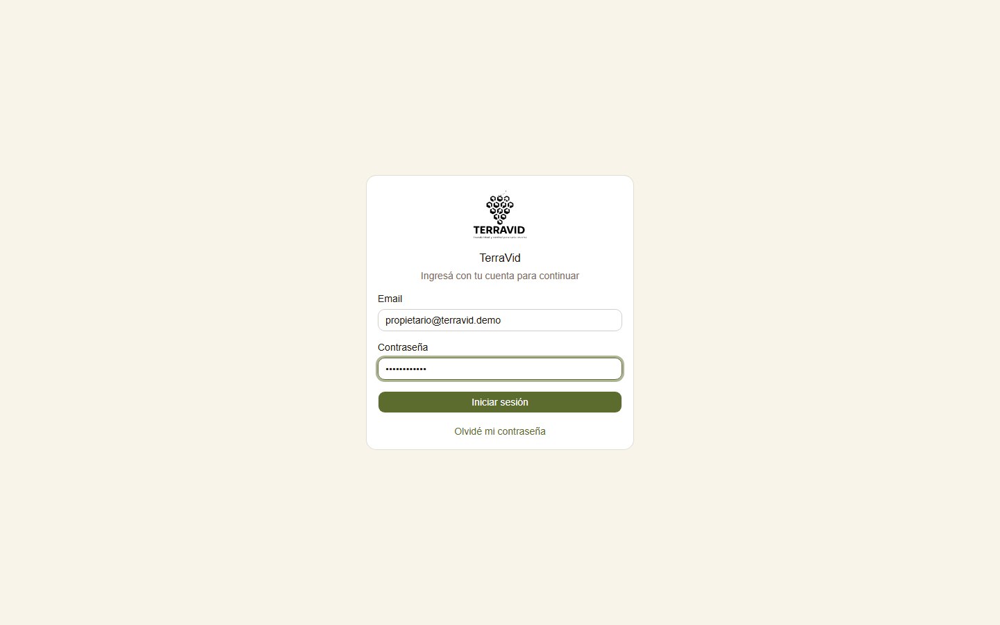

Si los datos son correctos, entrás al **Dashboard**. Si habías intentado abrir una pantalla en particular antes de iniciar sesión, el sistema te lleva directamente a esa pantalla.

### 2.2 Errores frecuentes al ingresar

| Mensaje | Qué significa | Qué hacer |
|---|---|---|
| **Email o contraseña incorrectos** | El email no existe o la contraseña no coincide. Por seguridad, el sistema no te dice cuál de los dos está mal. | Revisá que no tengas activado Bloq Mayús y volvé a intentar. Si no la recordás, usá **Olvidé mi contraseña**. |
| **Cuenta bloqueada por demasiados intentos. Intente en 15 minutos** | Hubo **5 intentos fallidos seguidos** con tu cuenta. | Esperá 15 minutos y volvé a intentar, o recuperá la contraseña. |
| **Tu cuenta está desactivada** | Otro Propietario desactivó tu usuario. | Pedile a otro Propietario de tu empresa que te reactive. |
| **Ingresá tu contraseña** / **Email inválido** | Dejaste un campo vacío o el email está mal escrito. | Completá el campo marcado en rojo. |

### 2.3 Cambio de contraseña obligatorio

Si tu contraseña está marcada como **temporal**, después de ingresar el sistema te muestra la pantalla **Cambiá tu contraseña** y no te deja usar ninguna otra pantalla hasta que definas una propia. Completá:

- **Contraseña actual**
- **Nueva contraseña**: entre 8 y 72 caracteres, con al menos una letra y un número, y distinta de la actual.
- **Repetir nueva contraseña**

y hacé clic en **Guardar contraseña**.

> Lo habitual es que un usuario nuevo defina su contraseña con el enlace que le llega por correo al darlo de alta (ver [4.6 Usuarios](#46-usuarios)), así que esta pantalla aparece pocas veces.

### 2.4 Recuperar la contraseña

1. En la pantalla de inicio de sesión, hacé clic en **Olvidé mi contraseña**.
2. Escribí tu email y confirmá.
3. Vas a ver el mensaje **Revisá tu correo**. Si el email existe, te llega un enlace.
4. Abrí el enlace del correo. Se abre la pantalla **Definí tu contraseña**: escribí la nueva contraseña dos veces y confirmá.
5. Vas a ver *"Contraseña actualizada. Ya podés iniciar sesión."*

> El enlace **vence a los 30 minutos y sirve una sola vez**. Si vence, pedí uno nuevo.

### 2.5 Duración de la sesión

- Mientras usás el sistema, la sesión se renueva sola en segundo plano (por defecto, cada 15 minutos), sin que tengas que hacer nada.
- Si pasás **7 días sin usar el sistema** (valor por defecto), te va a pedir la contraseña de nuevo.
- Los dos valores se pueden cambiar en **Configuración → Parámetros → Sesiones** (ver [4.7](#47-configuración)).

### 2.6 Cerrar sesión

Abajo a la izquierda, en la ficha con tu email, hacé clic en el ícono de **Cerrar sesión** (la flecha que sale de una puerta). Cerrá sesión siempre que uses una computadora compartida.

---

## 3. Cómo moverse por la aplicación

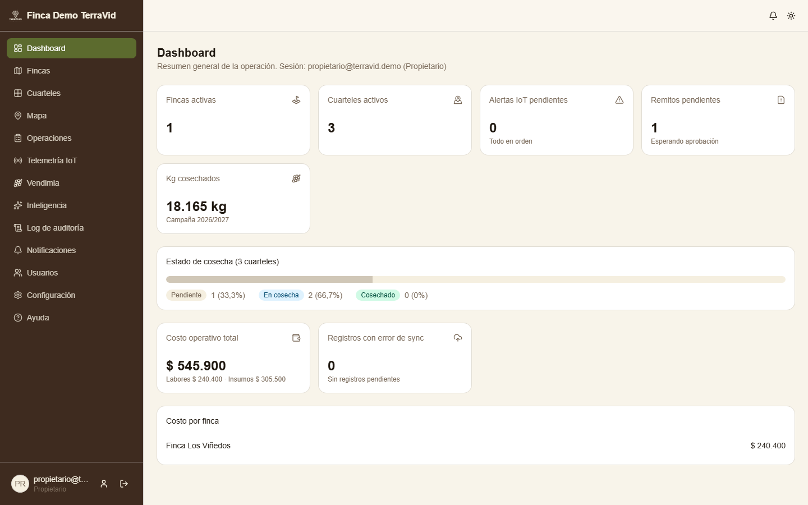

La pantalla tiene tres zonas:

### 3.1 Barra lateral (izquierda)

Arriba aparece el **nombre de tu empresa**. Debajo, la lista de secciones. El Propietario ve:

| Sección | Para qué sirve |
|---|---|
| **Dashboard** | Resumen de indicadores (pantalla de inicio). |
| **Fincas** | Alta y edición de fincas; acceso a los cuarteles de cada una. |
| **Cuarteles** | Búsqueda de cuarteles en todas las fincas. |
| **Mapa** | Ubicación de fincas y estado de cosecha de sus cuarteles. |
| **Operaciones** | Costeo por cuartel, insumos y tipos de labor. |
| **Telemetría IoT** | Sensores, sus lecturas y alertas. |
| **Vendimia** | Remitos, estado de cosecha y cuadrillas. |
| **Inteligencia** | Comparar campañas, correlación, recomendaciones y campañas. |
| **Log de auditoría** | Registro de todos los cambios. |
| **Notificaciones** | Avisos del sistema y alertas de sensores. |
| **Usuarios** | Usuarios de la empresa y sus roles. |
| **Configuración** | Parámetros y tablas maestras. |
| **Ayuda** | Manual, preguntas frecuentes y pedido de ayuda. |

La sección en la que estás queda resaltada en verde. Abajo de todo está la **ficha de usuario** con tu email y tu rol, el ícono de **Mi perfil** (silueta de persona) y el de **Cerrar sesión**.

> En pantallas angostas (por ejemplo un celular o una tablet vertical) la barra lateral se oculta: tocá el botón **Abrir menú** (tres rayas, arriba a la izquierda) para verla.

### 3.2 Barra superior (derecha)

- **Campana de notificaciones**: muestra un número rojo con las notificaciones sin leer (ver [4.9](#49-notificaciones)).
- **Tema claro / oscuro**: el ícono del sol (o la luna) cambia entre el tema claro y el oscuro.

### 3.3 Pestañas dentro de una sección

Varias secciones se dividen en pestañas, que aparecen debajo del título. Por ejemplo, **Operaciones** tiene *Costeo*, *Insumos* y *Tipos de labor*; **Vendimia** tiene *Remitos*, *Estado de cosecha* y *Cuadrillas*. La pestaña activa aparece subrayada.

### 3.4 Selector de finca y filtros

No hay un selector de finca global: cada pantalla que lo necesita tiene su propio desplegable **Finca** arriba de la tabla (Telemetría, Vendimia, Inteligencia, Costeo). En algunas pantallas tenés que elegir una finca antes de ver datos.

Otras pantallas tienen filtros de texto, estado o fechas (**Desde** / **Hasta**). Cuando hay filtros aplicados aparece un botón **Limpiar filtros** o **Ver todos** para quitarlos.

### 3.5 Tablas, menú "..." y paginación

- Al final de cada fila suele haber un botón **"..."** (tres puntos) con las acciones de ese elemento: *Editar*, *Dar de baja*, etc.
- Las acciones que borran o dan de baja siempre piden confirmación.
- En las tablas largas, abajo aparece *"Mostrando 1–20 de N"*, el selector **Filas** (10, 20, 50 o 100 por página) y las flechas para pasar de página.

### 3.6 Botón Volver

Las pantallas de detalle (cuarteles de una finca, historial de un cuartel, pesajes, serie de un sensor, detalle de un remito) tienen arriba a la izquierda un enlace **← Volver a...** que te lleva a la pantalla anterior.

### 3.7 Mensajes del sistema

Cuando guardás algo, aparece un aviso breve arriba a la derecha (por ejemplo *"Finca creada correctamente"*). Si algo falla, el aviso es rojo y explica el motivo. Si una pantalla no puede cargar los datos, muestra *"No se pudieron cargar los datos"* con un botón **Reintentar**.

---

## 4. Funcionalidades

### 4.1 Fincas y cuarteles

**Para qué sirve:** cargar la estructura productiva de la empresa. Una **finca** es el establecimiento; cada finca se divide en **cuarteles**, que son las parcelas sobre las que se registra todo el trabajo y la cosecha (HU-08, HU-09).

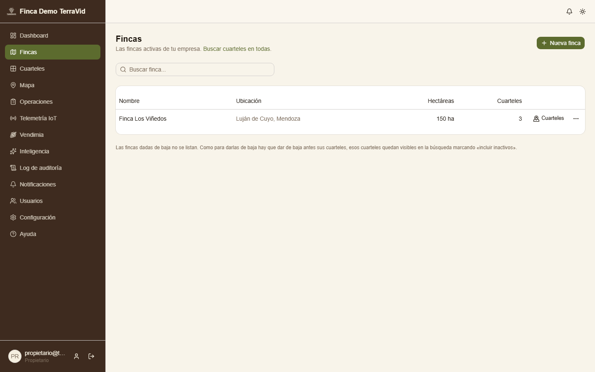

#### Dar de alta una finca

1. En la barra lateral, entrá a **Fincas**.
2. Hacé clic en **+ Nueva finca**.
3. Completá **Nombre**, **Ubicación** y **Hectáreas** (mayor que 0, hasta 2 decimales).
4. Opcionalmente, cargá **Latitud** (de -90 a 90) y **Longitud** (de -180 a 180). Sin coordenadas la finca no aparece en el mapa.
5. Hacé clic en **Crear finca**.

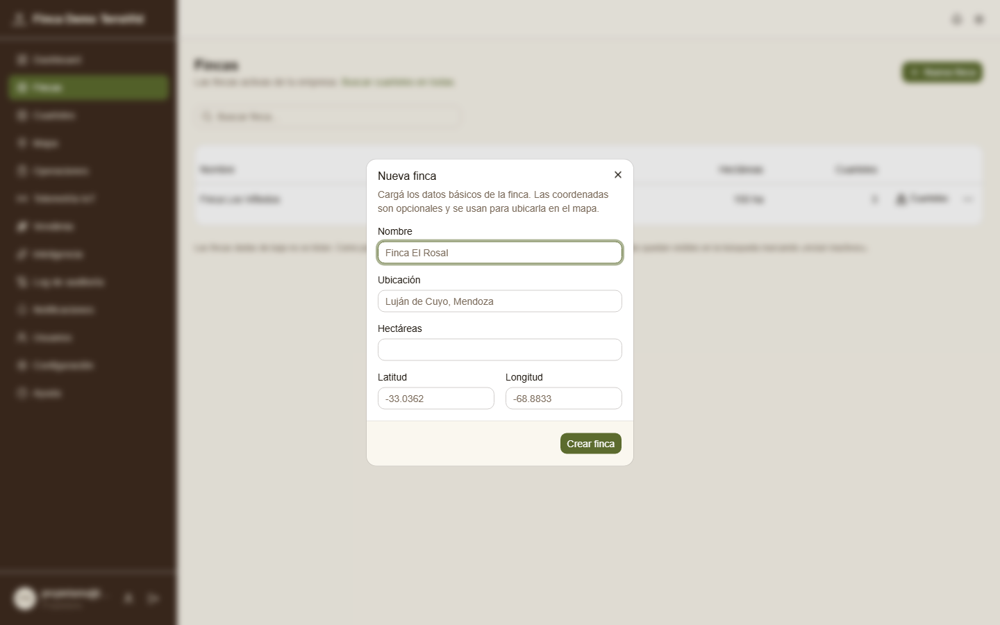

#### Editar o dar de baja una finca

1. En **Fincas**, hacé clic en **"..."** al final de la fila.
2. Elegí **Editar** para cambiar los datos y luego **Guardar cambios**, o **Dar de baja** y confirmá.

> **Importante:** para dar de baja una finca primero tenés que dar de baja sus cuarteles. Una finca dada de baja **no se puede volver a activar desde la aplicación**; su historial de labores y pesajes se conserva.

El cuadro **Buscar finca...** filtra el listado por nombre.

#### Cuarteles de una finca

1. En **Fincas**, hacé clic en el botón **Cuarteles** de la fila de la finca.
2. Se abre la lista de cuarteles activos de esa finca, con su variedad, sistema de conducción, año, hectáreas y estado de **Cosecha**.

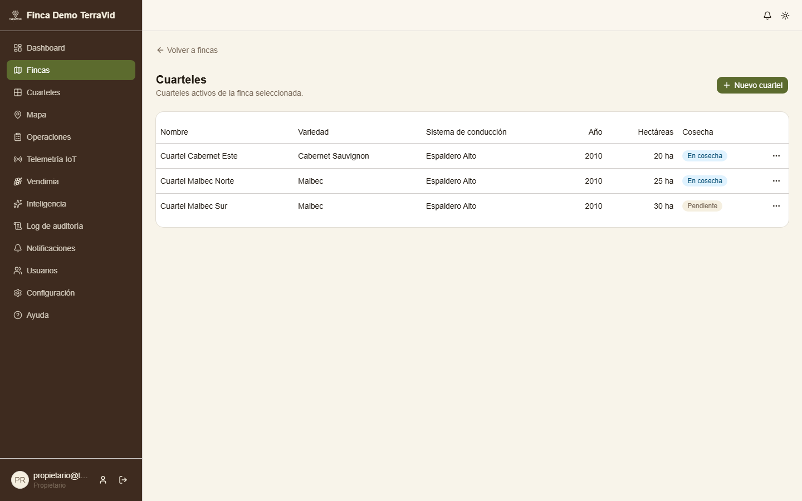

**Dar de alta un cuartel:**

1. Hacé clic en **+ Nuevo cuartel**.
2. Completá **Nombre**, **Variedad** y **Sistema de conducción** (obligatorios; las opciones salen de las tablas maestras, ver [4.7](#47-configuración)).
3. Opcionalmente: **Clon**, **Año de implantación** (de 1900 al año actual), **Hectáreas**, **Latitud** y **Longitud**.
4. Hacé clic en **Crear cuartel**.

> El **estado de cosecha** (Pendiente / En cosecha / Cosechado) no se carga a mano: lo actualiza el sistema a partir de los pesajes y los remitos.

**Acciones del menú "..." de un cuartel:**

- **Ver historial**: abre el historial de labores del cuartel (ver [5.3](#53-historial-de-labores-por-cuartel)).
- **Editar**: cambia los datos del cuartel (no se puede mover a otra finca).
- **Dar de baja**: el cuartel deja de aparecer en los listados y deja de aceptar labores y pesajes. Su historial se conserva.

#### Buscar cuarteles en todas las fincas

1. En la barra lateral, entrá a **Cuarteles** (o usá el enlace *Buscar cuarteles en todas* de la pantalla Fincas).
2. Filtrá por **Nombre**, **Finca**, **Variedad**, **Cosecha** y **Estado** (*Activos* o *Dados de baja*).
3. Hacé clic en **Nombre** en el encabezado para ordenar. **Limpiar filtros** vuelve todo a cero.

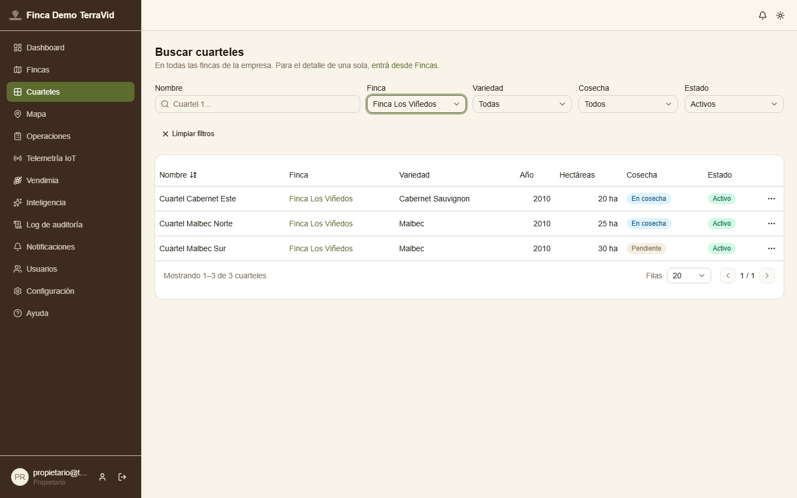

> Para ver un cuartel dado de baja (por ejemplo, de una finca que ya no está activa), elegí **Estado → Dados de baja**.

#### Mapa

1. En la barra lateral, entrá a **Mapa** (HU-10).
2. En **Ver**, elegí **Todas las fincas** para ver un marcador por finca, o una finca en particular para ver sus cuarteles.
3. Los marcadores de cuarteles tienen el **color de su estado de cosecha**; al pasar el mouse se ve el nombre y el estado escrito, y al hacer clic se abre una ficha con la finca, el estado, las hectáreas y el enlace **Ver cuarteles de la finca**. Al pie del mapa hay una referencia de colores.

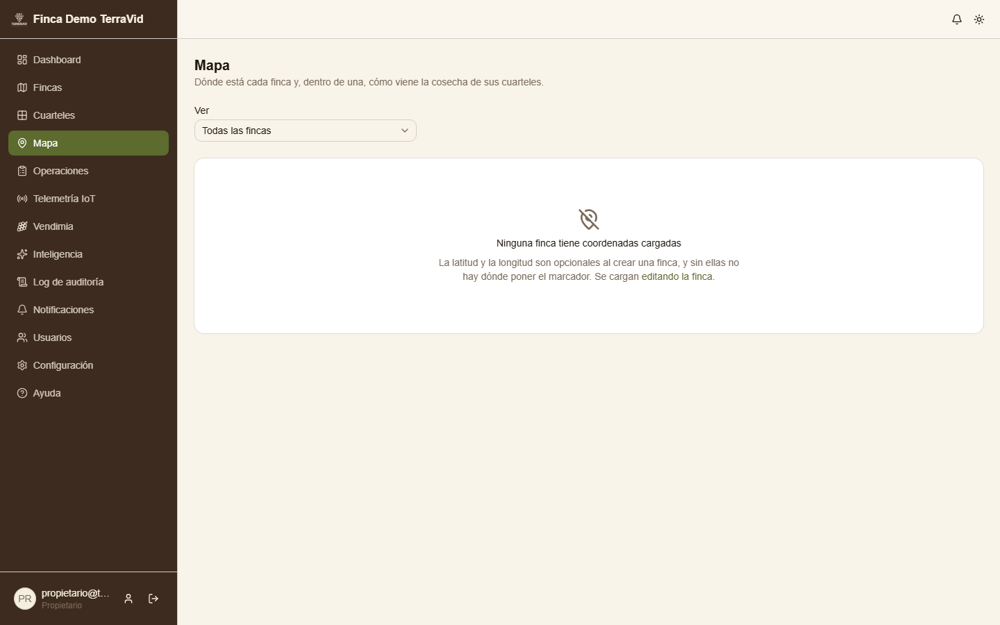

> Si ves *"Ninguna finca tiene coordenadas cargadas"*, editá la finca (o el cuartel) y completá latitud y longitud.

---

### 4.2 Operaciones: insumos y tipos de labor

**Para qué sirve:** definir qué trabajos (tipos de labor) y qué productos (insumos) se pueden registrar desde el campo, y **cuánto cuesta cada uno**. Con esos costos el sistema calcula el costeo de cada cuartel (HU-16).

Las dos pestañas, **Insumos** y **Tipos de labor**, funcionan igual.

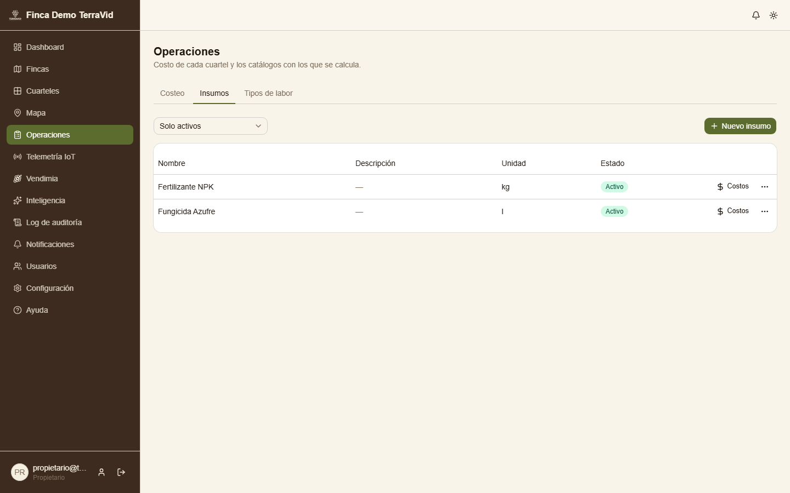

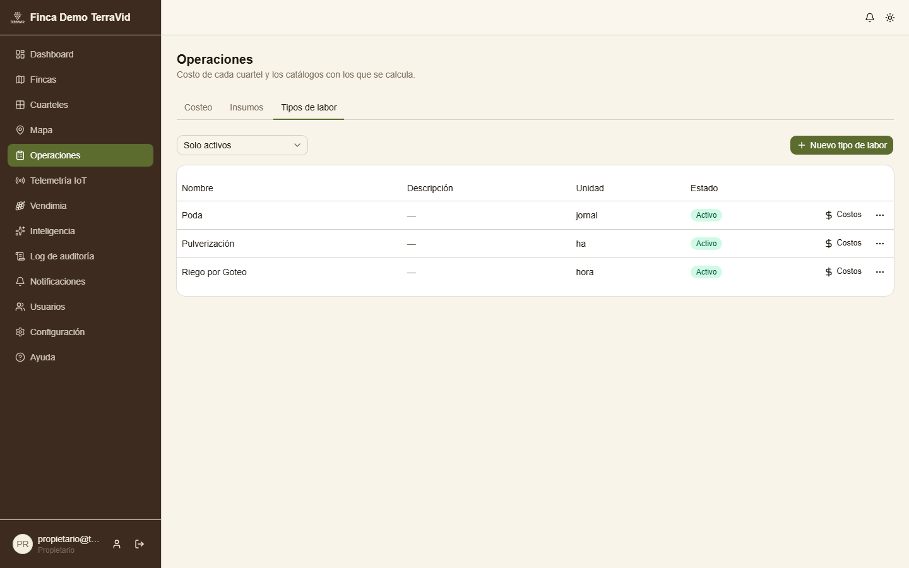

#### Crear un insumo o un tipo de labor

1. Entrá a **Operaciones** y elegí la pestaña **Insumos** o **Tipos de labor**.
2. Hacé clic en **+ Nuevo insumo** o **+ Nuevo tipo de labor**.
3. Completá **Nombre**, **Descripción** (opcional, hasta 300 caracteres) y **Unidad de medida** (cómo se mide: kilos o litros para un insumo; jornales, horas o hectáreas para una labor).
4. Cargá el **Costo unitario inicial**. Este costo **rige desde hoy**.
5. Hacé clic en **Crear**.

#### Cambiar un costo

El costo **no se edita**: se agrega una vigencia nueva, para no reescribir lo que ya se registró.

1. En la fila del ítem, hacé clic en **$ Costos**.
2. Se abre el historial de costos. El que rige hoy tiene la marca **Vigente**; uno con fecha futura aparece como **Programado**.
3. Hacé clic en **+ Nuevo costo**, cargá el **Nuevo costo** (mayor que 0) y la fecha **Rige desde** (hoy o más adelante).
4. Hacé clic en **Registrar costo**.

#### Editar o dar de baja

En el menú **"..."** de la fila: **Editar** (nombre, descripción, unidad) o **Dar de baja**. Un ítem dado de baja deja de ofrecerse al cargar labores nuevas; las ya registradas conservan su costo. Para verlos, cambiá el filtro **Solo activos** a **Incluir dados de baja**.

#### Importante: los costos no son retroactivos

Cuando un capataz sincroniza una labor, el sistema busca el costo **vigente en la fecha de esa labor**. Como las vigencias siempre arrancan **hoy o más adelante**, cualquier labor con fecha **anterior** a la vigencia del primer costo **no tiene costo** y queda con **error de sincronización** (*"No hay costo vigente para el tipo de labor a la fecha…"*). Lo mismo pasa con los insumos y con las tarifas de las cuadrillas.

Por eso:

1. **Antes de que empiece la campaña**, creá todos los tipos de labor e insumos con su costo, y asigná la tarifa de cada cuadrilla.
2. Recién después, los capataces pueden empezar a registrar desde la app móvil.
3. Si el dashboard muestra **Registros con error de sync** mayor que cero, hay trabajo de campo que no entró al sistema. No se puede arreglar cargando un costo con fecha pasada; pedí ayuda desde **Ayuda → Pedir ayuda** (ver [4.11](#411-ayuda-y-soporte)).

---

### 4.3 Telemetría IoT

**Para qué sirve:** registrar los sensores (nodos) instalados en el viñedo, ver lo que miden y recibir alertas cuando una lectura sale del rango aceptable (HU-18 a HU-22).

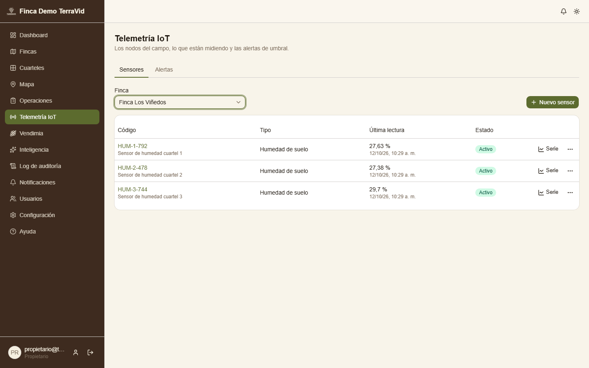

#### Ver los sensores de una finca

1. Entrá a **Telemetría IoT** → pestaña **Sensores**.
2. Elegí la **Finca**. La tabla muestra el **Código**, el **Tipo**, la **Última lectura** (valor y fecha/hora que reportó el nodo) y el **Estado**.

#### Dar de alta un sensor

1. Con la finca elegida, hacé clic en **+ Nuevo sensor**.
2. Completá **Código** (la etiqueta física del nodo, la misma que tiene programada), **Tipo** (Temperatura, Humedad de suelo, Humedad ambiente, Pluviómetro, Radiación solar o Viento) y **Descripción** opcional (por ejemplo, dónde está instalado).
3. Hacé clic en **Crear sensor**.

> El **Tipo** no se puede cambiar después. Si cambiás el **Código**, hay que reprogramar el nodo o dejará de enviar lecturas.

#### Credencial MQTT del sensor

Para que el nodo pueda enviar sus lecturas necesita una credencial:

1. En el menú **"..."** del sensor, elegí **Credencial MQTT**.
2. Hacé clic en **Generar credencial**.
3. Se muestran **Broker**, **Usuario**, **Contraseña** y **Tópico**. **Copialos en ese momento**: la contraseña no se vuelve a mostrar.

> Si el sensor ya tenía una credencial, la anterior deja de funcionar en cuanto generás la nueva, y el nodo queda desconectado hasta que se le cargue.

#### Otras acciones del menú "..."

- **Editar**: cambiar código o descripción.
- **Dar de baja**: el sensor deja de aparecer; las lecturas recibidas se conservan, pero las nuevas se rechazan.

#### Configurar umbrales

1. Hacé clic en el código del sensor o en **Serie**.
2. Arriba a la derecha, hacé clic en **Umbrales**.
3. Cargá el **Mínimo**, el **Máximo** o los dos (al menos uno; el mínimo tiene que ser menor que el máximo).
4. Guardá. Vas a ver *"Umbral guardado"*.

Cuando una lectura sale de ese rango, el sistema genera una **alerta** y envía una **notificación** a los responsables de la finca.

#### Revisar alertas

1. Entrá a **Telemetría IoT** → pestaña **Alertas**. Si hay alertas pendientes, la pestaña muestra un número rojo.
2. Cada alerta indica si el valor **Superó el máximo** o **Cayó del mínimo**, el sensor, la finca, el valor medido contra el umbral y la fecha.
3. Una vez que la atendiste, hacé clic en **Revisada**.

> Marcar una alerta como revisada la saca de la bandeja, pero **no cambia el umbral**: si la causa sigue, la próxima lectura fuera de rango genera otra.

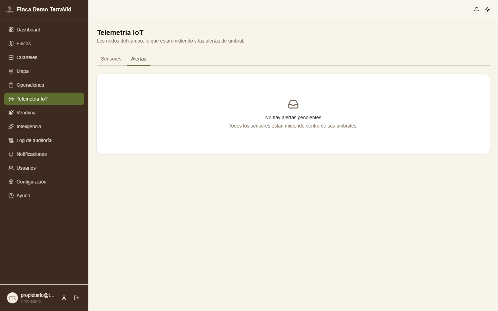

Para el gráfico de lecturas de cada sensor, ver [5.6 Gráficos de telemetría](#56-gráficos-de-telemetría).

---

### 4.4 Vendimia

**Para qué sirve:** seguir la cosecha desde el pesaje en el cuartel hasta el remito aprobado y liquidado por la bodega (HU-23 a HU-28). Tiene tres pestañas: **Remitos**, **Estado de cosecha** y **Cuadrillas**.

El circuito es:

1. El capataz registra los **pesajes** desde la app móvil (cada pesaje queda *Pendiente de remito*).
2. Se genera un **borrador de remito** con los pesajes de un cuartel en una jornada.
3. El Propietario (o el Agrónomo) **aprueba** o **rechaza** el borrador.
4. Cuando la bodega paga, se carga la **liquidación** del remito aprobado.

#### Cuadrillas y tarifas

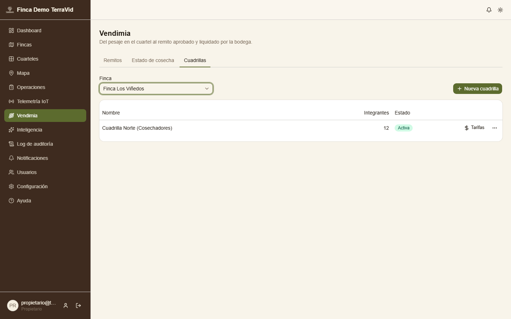

**Crear una cuadrilla:**

1. Entrá a **Vendimia** → **Cuadrillas** y elegí la **Finca**.
2. Hacé clic en **+ Nueva cuadrilla**.
3. Completá **Nombre** e **Integrantes** (número entero, al menos 1) y hacé clic en **Crear**.

**Fijar la tarifa por kilo** (solo el Propietario):

1. En la fila de la cuadrilla, hacé clic en **$ Tarifas**.
2. Se ve el historial de tarifas (**Vigente** / **Programada**). Hacé clic en **+ Nueva tarifa**.
3. Cargá la **Nueva tarifa** (precio por kg, mayor que 0) y **Rige desde** (hoy o más adelante).
4. Hacé clic en **Registrar tarifa**.

> Igual que con los costos, la tarifa **no es retroactiva**: un pesaje con fecha anterior a la tarifa vigente queda con error al sincronizar. Asigná la tarifa antes de que la cuadrilla empiece a cosechar.

En el menú **"..."** de la cuadrilla podés **Editar** o **Dar de baja** (deja de ofrecerse para pesajes nuevos; los ya cargados conservan su tarifa).

#### Generar un borrador de remito

1. Entrá a **Vendimia** → **Remitos**.
2. Hacé clic en **Generar borrador**.
3. Elegí la **Finca**, el **Cuartel** y la **Jornada** (solo entran los pesajes de ese día que estén pendientes de remito).
4. Confirmá. El sistema te lleva al detalle del borrador para que revises qué pesajes entraron.

> Un cuartel puede tener **un solo borrador a la vez**. Si no hay pesajes pendientes para ese cuartel y ese día, el sistema avisa y no genera nada.

#### Aprobar o rechazar un remito

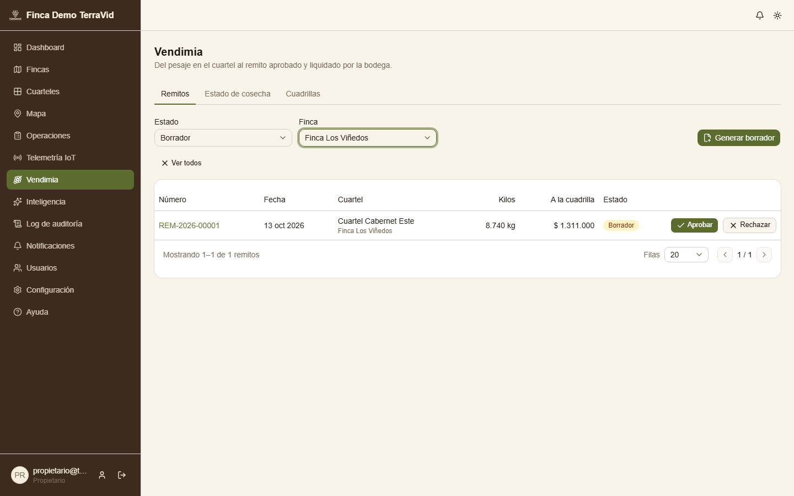

La pestaña **Remitos** abre filtrada en **Estado: Borrador**, o sea lo que está esperando tu aprobación. Podés filtrar también por **Finca** y quitar los filtros con **Ver todos**.

1. Hacé clic en el número del remito (por ejemplo, *REM-2026-00001*) para ver el detalle: finca, cuartel, variedad, kilos despachados y los **pesajes incluidos** con cuadrilla, kilos, tarifa y monto a pagar.
2. Si está todo bien, hacé clic en **Aprobar** y confirmá. Los pesajes pasan a liquidados y el cuartel puede quedar como **Cosechado**.
3. Si hay un error, hacé clic en **Rechazar**, escribí el **Motivo del rechazo** (al menos 10 caracteres; es lo único que va a ver quien cargó los pesajes) y confirmá. Los pesajes quedan **observados**: no vuelven a la cola y hay que corregirlos antes de que entren en otro remito.

Los botones **Aprobar** y **Rechazar** también están en la fila de la tabla. Solo aparecen en remitos en borrador.

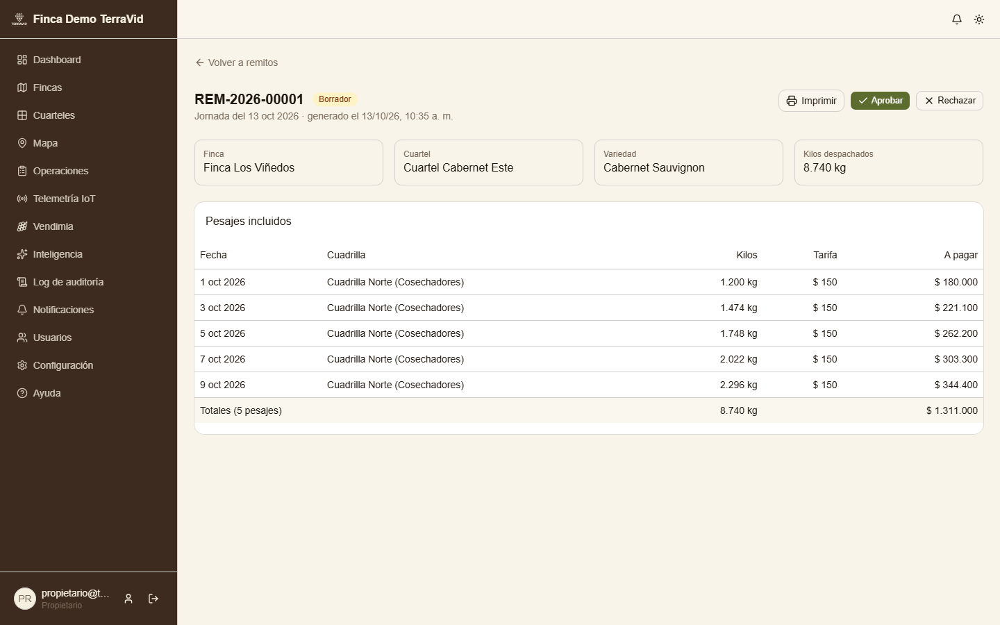

#### Cargar la liquidación de la bodega

1. Abrí un remito **aprobado**.
2. Hacé clic en **Cargar liquidación**.
3. Completá **Bodega**, **Kilos aceptados** (se muestran los despachados como referencia), **Precio por kg**, **Descuentos** (opcional; no pueden superar el importe bruto), **Fecha de liquidación** y **N.º de comprobante** (opcional).
4. Hacé clic en **Registrar liquidación**.

La liquidación es el **ingreso** del cuartel: con ella se calcula el margen bruto en Operaciones → Costeo. Si te equivocaste, el mismo botón pasa a llamarse **Editar liquidación**.

#### Imprimir un remito

En el detalle del remito, hacé clic en **Imprimir**. Se abre el cuadro de impresión del navegador, desde donde también podés guardarlo como PDF. La versión impresa no incluye la barra lateral.

El **Estado de cosecha** y los **pesajes por cuartel** se explican en [5.4](#54-estado-de-cosecha).

---

### 4.5 Campañas y metas de cosecha

**Para qué sirve:** una **campaña** es el período agrícola (por ejemplo, del 1 de julio al 30 de junio). El dashboard la usa para contar los kilos cosechados, y la inteligencia agronómica para comparar períodos (HU-31).

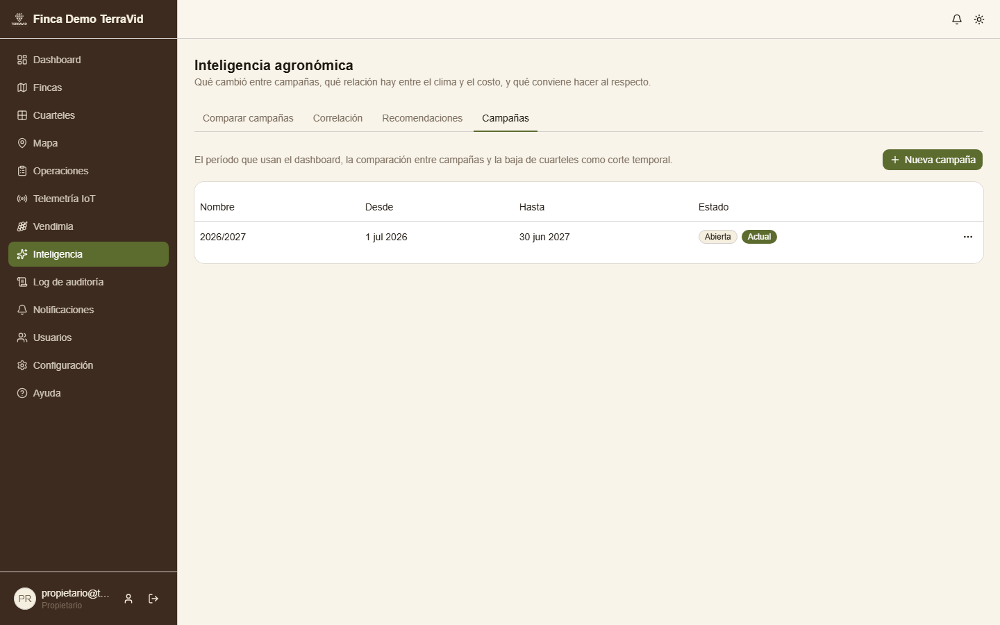

1. Entrá a **Inteligencia** → pestaña **Campañas**.
2. Hacé clic en **+ Nueva campaña**, completá **Nombre** (como la llama el productor, por ejemplo *2026/2027*), **Desde** y **Hasta** (inclusive; el fin tiene que ser posterior al inicio) y hacé clic en **Crear campaña**.

La columna **Estado** muestra si la campaña está **Abierta** o **Cerrada**, y la marca **Actual** indica la que rige hoy.

En el menú **"..."** de la campaña:

- **Editar**: cambiar nombre o fechas.
- **Metas de cosecha**: cargar la meta en kilos de cada cuartel y ver cuánto se cosechó.
- **Cerrar campaña**: deja de ser "la actual" aunque hoy caiga dentro de su rango (útil si la vendimia terminó antes). Sigue siendo consultable. Con **Reabrir** se revierte.

> Sin ninguna campaña cargada, el dashboard cuenta los kilos por año calendario, que en Mendoza parte la vendimia al medio. Cargá la campaña al inicio de la temporada.

---

### 4.6 Usuarios

**Para qué sirve:** dar acceso a las personas de tu empresa y definir qué puede hacer cada una (HU-05, HU-06).

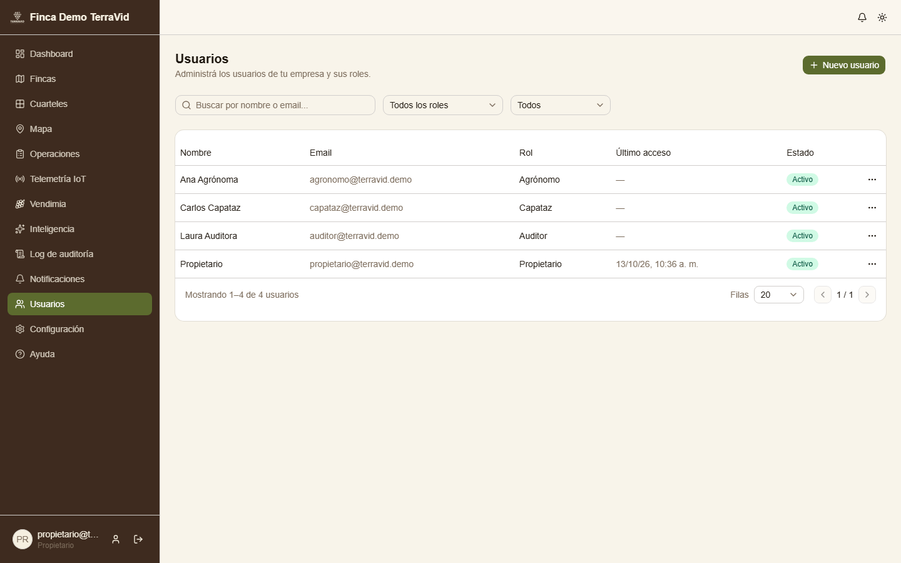

Los roles disponibles son:

| Rol | Resumen |
|---|---|
| **Propietario** | Todo dentro de la empresa. |
| **Agrónomo** | Cuarteles, operaciones y costos, telemetría, vendimia (incluida la aprobación de remitos) e inteligencia. No administra usuarios ni fincas. |
| **Capataz** | Usa la app móvil: registra labores, insumos y pesajes. No ve costos. |
| **Auditor** | Solo lectura: fincas, cuarteles, historial de labores y log de auditoría. |

#### Dar de alta un usuario

1. Entrá a **Usuarios** y hacé clic en **+ Nuevo usuario**.
2. Completá **Nombre** (nombre y apellido), **Email** y **Rol**.
3. **Contraseña (opcional)**: si la dejás vacía, al usuario le llega un correo con un enlace **válido por 48 horas** para que defina la suya (recomendado). Si la completás, tiene que tener al menos 8 caracteres, una letra y un número.
4. Hacé clic en **Crear usuario**.

> Para que lleguen los correos tiene que estar configurado el **Correo saliente (SMTP)** en Configuración. Si el enlace vence, el usuario puede pedir otro con **Olvidé mi contraseña**.

#### Cambiar el rol o reactivar un usuario

1. En el menú **"..."** del usuario, elegí **Editar**.
2. Cambiá **Nombre**, **Email**, **Rol** o **Estado** (*Activo* / *Inactivo*) y guardá.

> No podés cambiar tu propio rol: tiene que hacerlo otro Propietario.

#### Desactivar un usuario

En el menú **"..."**, elegí **Desactivar** y confirmá. El usuario no va a poder iniciar sesión. Se puede reactivar después desde **Editar → Estado: Activo**. No podés desactivarte a vos mismo.

Arriba de la tabla podés buscar **por nombre o email** y filtrar por rol y por estado (*Todos*, *Activos*, *Inactivos*). La columna **Último acceso** muestra cuándo ingresó cada uno por última vez.

---

### 4.7 Configuración

**Para qué sirve:** ajustar los parámetros generales de la empresa y las listas de valores que se usan al cargar cuarteles (HU-33, HU-34).

#### Parámetros

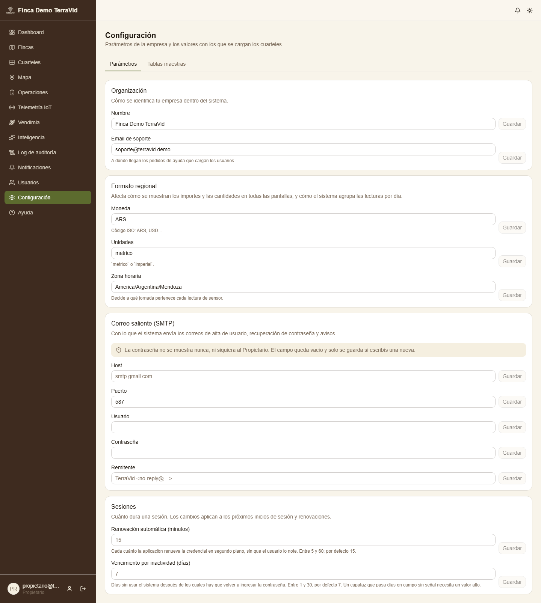

Cada campo tiene su propio botón **Guardar**: cambiá el valor y hacé clic en el **Guardar** de ese campo. Los grupos son:

| Grupo | Campos | Para qué |
|---|---|---|
| **Organización** | Nombre, Email de soporte | El nombre aparece arriba en la barra lateral. Al email de soporte llegan los pedidos de ayuda. |
| **Formato regional** | Moneda (código ISO: ARS, USD…), Unidades (`metrico` o `imperial`), Zona horaria | Cómo se muestran importes y cantidades; la zona horaria decide a qué día pertenece cada lectura de sensor. |
| **Correo saliente (SMTP)** | Host, Puerto, Usuario, Contraseña, Remitente | Con esto el sistema envía los correos de alta de usuario, recuperación de contraseña y avisos. La contraseña nunca se muestra: el campo queda vacío y solo se guarda si escribís una nueva. |
| **Sesiones** | Renovación automática (minutos, entre 5 y 60, por defecto 15), Vencimiento por inactividad (días, entre 1 y 30, por defecto 7) | Cuánto dura una sesión. Los cambios aplican en los próximos ingresos. Un capataz que pasa días en el campo sin señal necesita un vencimiento alto. |

#### Tablas maestras

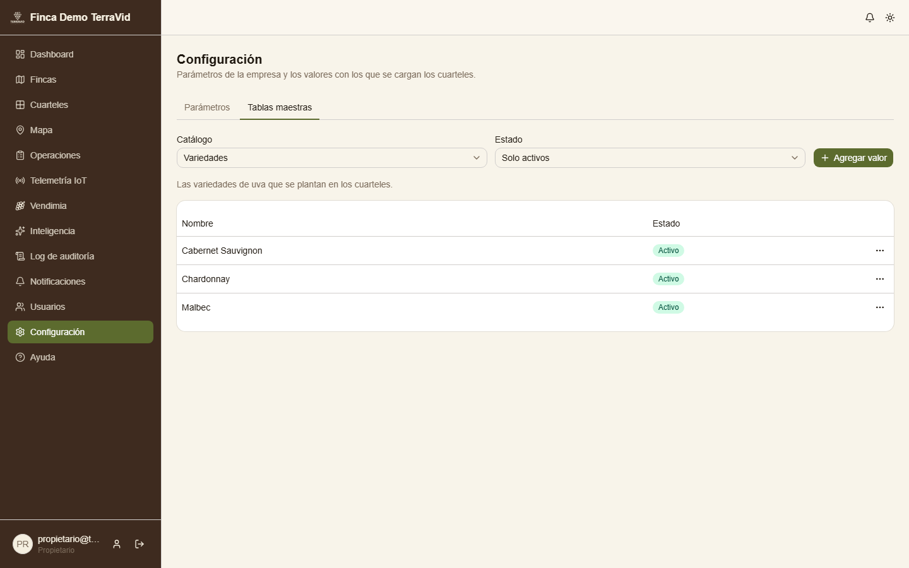

1. Entrá a **Configuración** → pestaña **Tablas maestras**.
2. En **Catálogo**, elegí qué lista querés administrar: **Variedades**, **Sistemas de conducción**, **Estados de plantación** o **Unidades de medida**.
3. Hacé clic en **+ Agregar valor**, escribí el **Nombre** y hacé clic en **Agregar**.

En el menú **"..."** de cada valor:

- **Editar**: cambiar el nombre.
- **Dar de baja**: deja de ofrecerse en los formularios nuevos; los cuarteles que ya lo usan lo conservan.
- **Eliminar**: lo borra definitivamente. Solo se puede si ningún cuartel lo usa; si no, usá *Dar de baja*.

---

### 4.8 Log de auditoría

**Para qué sirve:** saber quién hizo cada cambio, cuándo y desde qué dirección IP. Es de **solo lectura**: nadie puede modificarlo (HU-07).

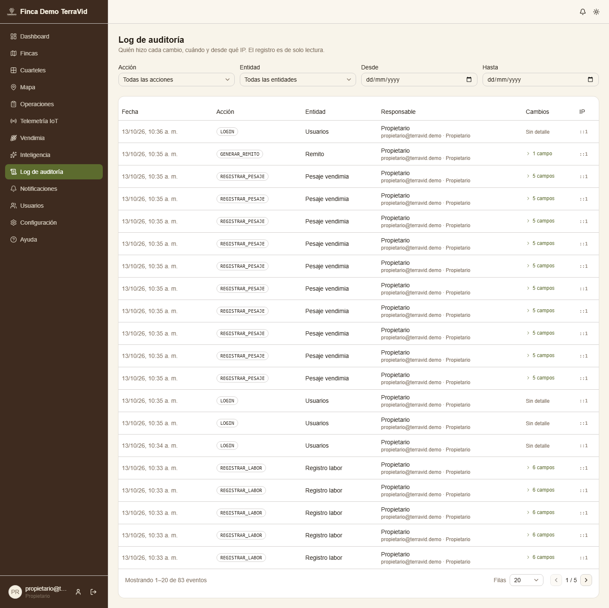

1. Entrá a **Log de auditoría**.
2. Filtrá por **Acción** (por ejemplo LOGIN, GENERAR_REMITO, REGISTRAR_PESAJE, REGISTRAR_LABOR), **Entidad**, **Desde** y **Hasta**.
3. Cada fila muestra la **Fecha**, la **Acción**, la **Entidad** afectada, el **Responsable** (nombre, email y rol), los **Cambios** y la **IP**.
4. En la columna **Cambios**, hacé clic en *"N campos"* para desplegar qué valores cambiaron.

Los eventos aparecen del más nuevo al más viejo, paginados. También se registran los intentos de ingreso fallidos.

---

### 4.9 Notificaciones

**Para qué sirve:** enterarte de las alertas de sensores y otros avisos del sistema sin tener que revisar cada sección (HU-22, HU-35).

**Desde la campana (barra superior):**

1. Si hay notificaciones sin leer, la campana muestra un número rojo (hasta *9+*). Se actualiza sola cada minuto.
2. Hacé clic en la campana para ver las últimas. Al hacer clic en una, se marca como leída y, si tiene un enlace, te lleva a la pantalla correspondiente.
3. **Marcar todas** las marca como leídas; **Ver todas** abre la pantalla de notificaciones.

**Desde la pantalla Notificaciones:**

- Pestañas **Todas** y **Sin leer (N)**.
- En cada notificación: **Ver** (abre la pantalla relacionada) y **Marcar leída**.
- Arriba a la derecha: **Marcar todas como leídas**.

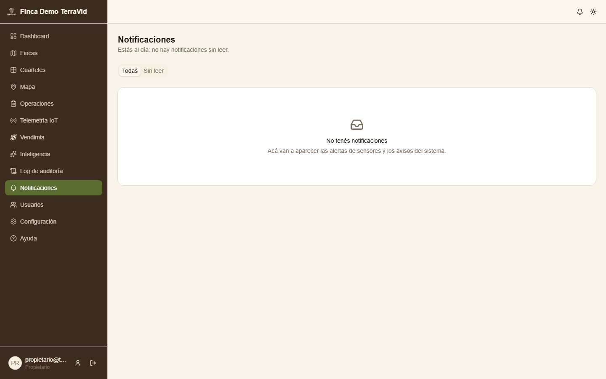

---

### 4.10 Mi perfil

**Para qué sirve:** ver y actualizar tus datos personales y cambiar tu contraseña (HU-04).

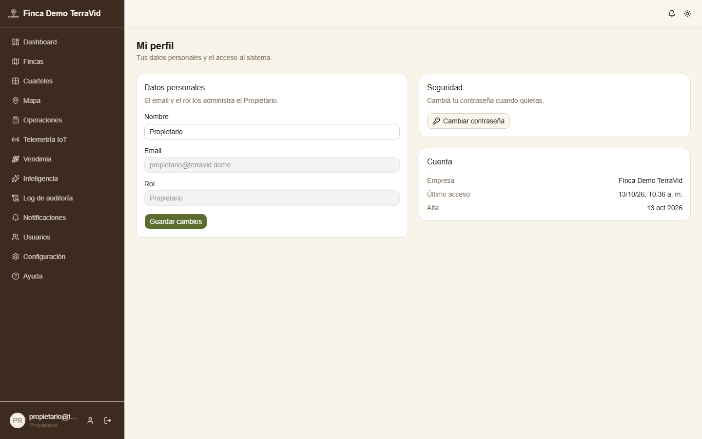

Entrá con el ícono de persona de la ficha de usuario (abajo a la izquierda).

- **Datos personales**: podés cambiar tu **Nombre** y hacer clic en **Guardar cambios**. El email y el rol se ven pero no se editan acá (los administra un Propietario desde Usuarios).
- **Seguridad**: **Cambiar contraseña** abre la pantalla para cambiarla (necesitás la contraseña actual).
- **Cuenta**: muestra la empresa, el último acceso y la fecha de alta.

---

### 4.11 Ayuda y soporte

**Para qué sirve:** consultar cómo se usa el sistema y pedir ayuda cuando algo no funciona (HU-36).

**Manual y FAQ**

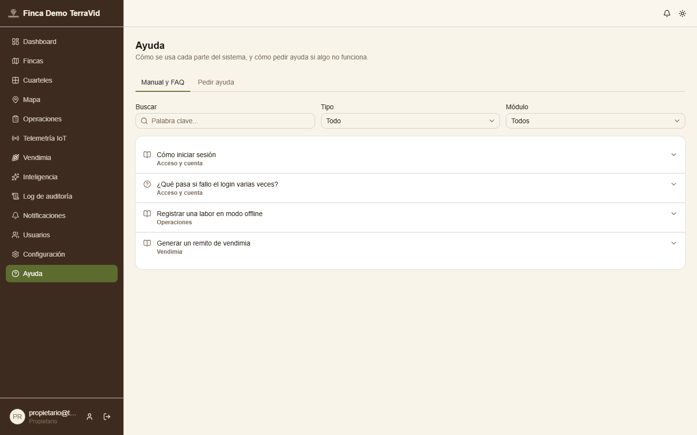

1. Entrá a **Ayuda** → pestaña **Manual y FAQ**.
2. Usá **Buscar** (palabra clave), **Tipo** (*Todo*, *Manual* o *Preguntas frecuentes*) y **Módulo**.
3. Hacé clic en un artículo para desplegarlo.

**Pedir ayuda**

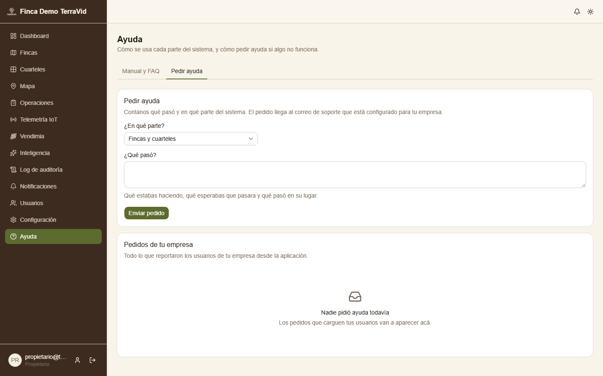

1. Entrá a **Ayuda** → pestaña **Pedir ayuda**.
2. En **¿En qué parte?**, elegí el módulo (Acceso y cuenta, Fincas y cuarteles, Operaciones, Telemetría, Vendimia o Reportes).
3. En **¿Qué pasó?**, contá qué estabas haciendo, qué esperabas y qué pasó (entre 10 y 1000 caracteres).
4. Hacé clic en **Enviar pedido**. El pedido llega al **email de soporte** configurado.

Como Propietario, abajo ves también **Pedidos de tu empresa**: todo lo que reportaron los usuarios de tu empresa.

---

## 5. Reportes

TerraVid no genera archivos de reporte: todos los reportes son **pantallas de consulta** que se actualizan con los datos sincronizados. **Ninguna pantalla tiene exportación a Excel, CSV o PDF**; la única que se puede imprimir es el **detalle del remito** (botón **Imprimir**, que también permite guardarlo como PDF desde el navegador).

### 5.1 Dashboard de indicadores

**Dónde:** **Dashboard** (es la pantalla de inicio) — HU-32.

| Tarjeta | Qué muestra | Cómo interpretarla |
|---|---|---|
| **Fincas activas** | Cantidad de fincas activas de la empresa. | — |
| **Cuarteles activos** | Cantidad de cuarteles activos. | — |
| **Alertas IoT pendientes** | Alertas de sensores todavía no revisadas. | *"Todo en orden"* si es 0; *"Requieren revisión"* si hay alguna. Revisalas en Telemetría → Alertas. |
| **Remitos pendientes** | Remitos en borrador. | *"Esperando aprobación"*: son los que tenés que aprobar o rechazar en Vendimia → Remitos. |
| **Kg cosechados** | Kilos de todos los pesajes de la campaña actual. | Debajo dice qué campaña se usa (por ejemplo *Campaña 2026/2027*). Sin campaña cargada se cuenta el año calendario. |
| **Estado de cosecha (N cuarteles)** | Barra con el reparto de cuarteles en **Pendiente**, **En cosecha** y **Cosechado**, con cantidad y porcentaje. | Muestra de un vistazo cuánto falta cosechar. |
| **Costo operativo total** | Suma del costo de labores y de insumos registrados. | Debajo se desglosa: *Labores $ … · Insumos $ …*. |
| **Registros con error de sync** | Labores que llegaron del campo pero no se pudieron registrar. | Si es mayor que 0, hay trabajo de campo que no entró al sistema (normalmente por falta de costo vigente, ver [4.2](#42-operaciones-insumos-y-tipos-de-labor)). |
| **Costo por finca** | Una línea por finca con su costo. | Suma **solo el costo de labores** (mano de obra) de cada finca, **sin insumos**. Por eso puede ser menor que el *Costo operativo total*. |
| **Alertas recientes sin revisar** | Últimas alertas no revisadas (sensor, si superó el máximo o cayó del mínimo, valor contra umbral y fecha). | Solo aparece cuando hay alguna. |

**Filtros:** no tiene. **Exportación:** no.

### 5.2 Costeo y margen bruto por cuartel

**Dónde:** **Operaciones** → pestaña **Costeo** — HU-15.

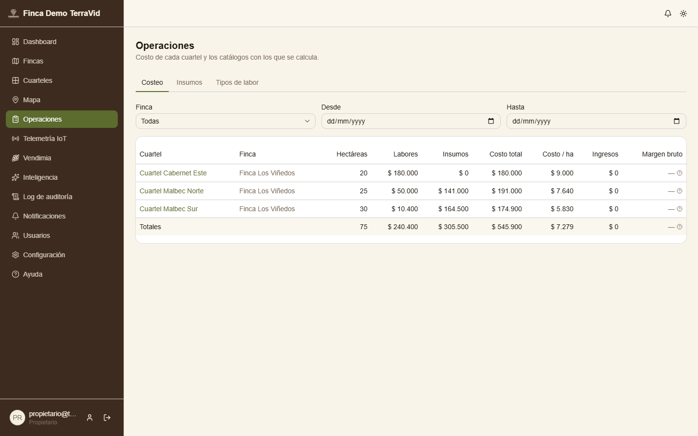

**Qué muestra:** una fila por cuartel activo con:

- **Hectáreas**.
- **Labores**: costo de la mano de obra registrada.
- **Insumos**: costo de los productos aplicados.
- **Costo total** (labores + insumos) y **Costo / ha**.
- **Ingresos**: lo que pagó la bodega según las liquidaciones cargadas.
- **Margen bruto**: ingresos menos costo total.

La última fila, **Totales**, suma todos los cuarteles.

**Filtros:** **Finca** (o *Todas*), **Desde** y **Hasta**.

**Cómo interpretarlo:**

- Un **"—"** con un signo de pregunta significa que el dato no se puede calcular; pasá el mouse por encima para ver el motivo (por ejemplo *"Sin liquidaciones de bodega cargadas todavía"* o *"El cuartel no tiene superficie cargada"*).
- El costo de cada labor es el que regía **en la fecha de la labor**: si después cambiás el costo, las labores ya registradas no cambian.
- Solo se cuentan las labores sincronizadas correctamente; las que quedaron con error no suman.
- Hacé clic en el nombre del cuartel para abrir su historial de labores.

**Exportación:** no.

### 5.3 Historial de labores por cuartel

**Dónde:** **Cuarteles** → **"..."** → **Ver historial**, o clic en el nombre del cuartel en **Costeo** — HU-17.

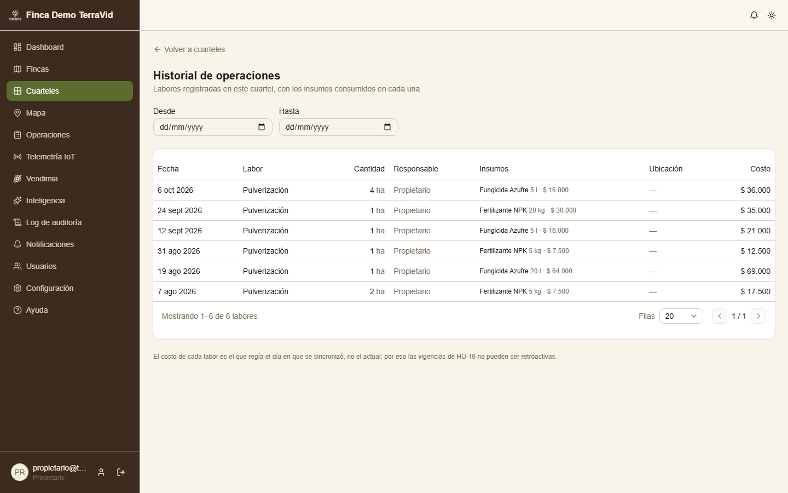

**Qué muestra:** cada labor registrada en el cuartel, de la más nueva a la más vieja, con **Fecha**, **Labor**, **Cantidad** (en la unidad del tipo de labor), **Responsable**, **Insumos** usados (cantidad y costo de cada uno), **Ubicación** (si el teléfono la registró) y **Costo** total de la labor.

**Filtros:** **Desde** y **Hasta**. Paginado.

**Cómo interpretarlo:** si una labor se registró con un ítem que ya estaba dado de baja, aparece marcada con un aviso. El costo de cada labor es el que regía cuando se registró.

**Exportación:** no.

### 5.4 Estado de cosecha

**Dónde:** **Vendimia** → pestaña **Estado de cosecha** — HU-28.

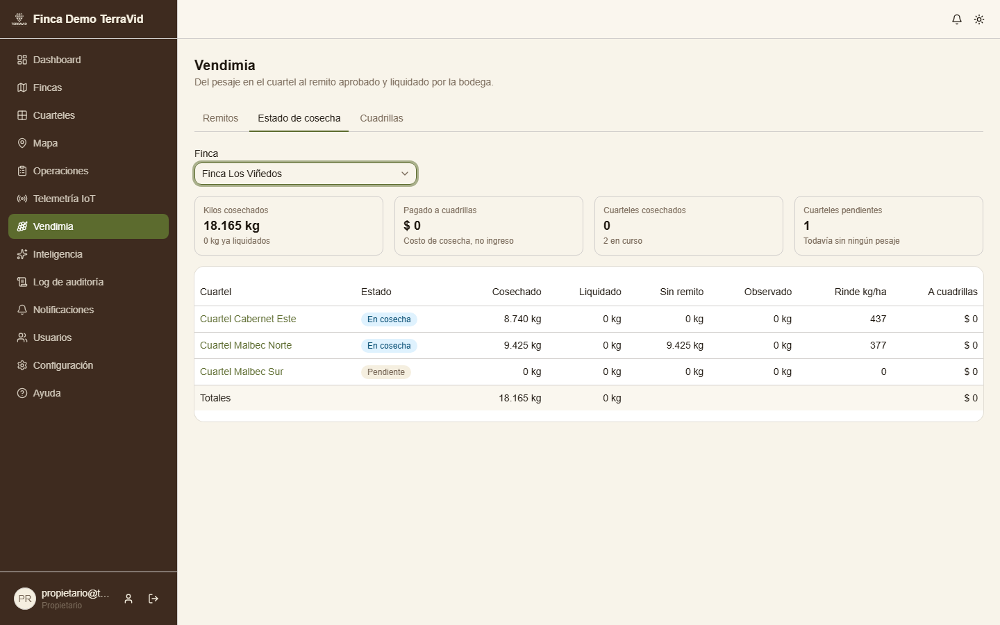

**Qué muestra:** primero hay que elegir la **Finca**. Arriba aparecen cuatro resúmenes:

- **Kilos cosechados** (y cuántos ya están liquidados).
- **Pagado a cuadrillas**: lo que se pagó a las cuadrillas por pesajes liquidados. Es **costo de cosecha, no ingreso**.
- **Cuarteles cosechados** (y cuántos en curso).
- **Cuarteles pendientes**: todavía sin ningún pesaje.

Debajo, una fila por cuartel con: **Estado**, **Cosechado**, **Liquidado**, **Sin remito** (kilos pesados que todavía no entraron en ningún remito), **Observado** (kilos de remitos rechazados), **Rinde kg/ha** y **A cuadrillas**, más una fila de **Totales**.

**Cómo interpretarlo:** si un cuartel tiene kilos *Sin remito*, falta generar el borrador. Si tiene kilos *Observados*, hay pesajes de un remito rechazado que hay que corregir.

**Pesajes de un cuartel:** hacé clic en el nombre del cuartel para ver sus pesajes (solo lectura; se cargan desde la app móvil): **Fecha**, **Cuadrilla**, **Kilos**, **Tarifa**, **A pagar**, **Estado** (*Pendiente de remito*, *En remito*, *Liquidado* u *Observado*), **Remito** y **Ubicación**.

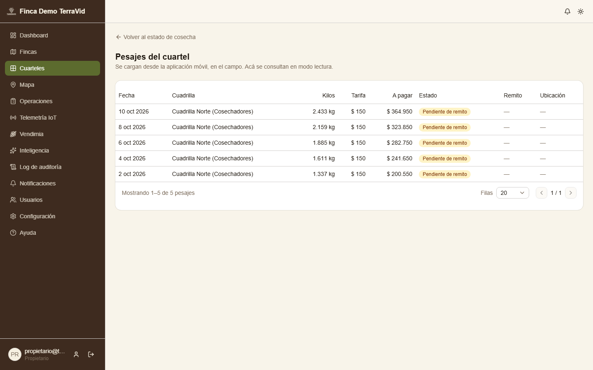

**Exportación:** no.

### 5.5 Remitos y liquidaciones

**Dónde:** **Vendimia** → pestaña **Remitos**, y el detalle de cada remito — HU-25, HU-26, HU-27.

**Qué muestra:** el listado de remitos con **Número**, **Fecha**, **Cuartel** (y finca), **Kilos**, monto **A la cuadrilla** y **Estado** (*Borrador*, *Aprobado* o *Rechazado*). El detalle muestra los pesajes incluidos con sus totales, el motivo del rechazo (si fue rechazado) y la **Liquidación de la bodega** (si ya se cargó): bodega, kilos aceptados, precio por kg e importe neto.

**Filtros:** **Estado** (abre en *Borrador*) y **Finca**. Paginado.

**Cómo interpretarlo:** *A la cuadrilla* es lo que se paga a los cosechadores (kilos × tarifa). El *Importe neto* de la liquidación es lo que paga la bodega y es el ingreso que alimenta el margen bruto.

**Exportación:** el detalle del remito se puede **imprimir** (y guardar como PDF desde el cuadro de impresión del navegador). El listado no se exporta.

### 5.6 Gráficos de telemetría

**Dónde:** **Telemetría IoT** → clic en el código de un sensor o en **Serie** — HU-20.

**Qué muestra:** la evolución de lo que midió el sensor. Con **7 días** cada punto es el **promedio por hora**; con **30 días** o **90 días**, el **promedio por día**. Si el sensor tiene umbrales, el gráfico muestra las líneas **mín** y **máx** en rojo y arriba indica *"Alerta fuera de X – Y"*.

**Filtros:** período (**7 días**, **30 días** o **90 días**) y vista **Gráfico** o **Tabla**. La tabla muestra, por período, el **Promedio**, el **Mínimo**, el **Máximo** y la cantidad de **Lecturas**.

**Cómo interpretarlo:** los días se calculan en la zona horaria de la empresa (Configuración → Formato regional). Un punto por encima de la línea máx o por debajo de la mín generó una alerta.

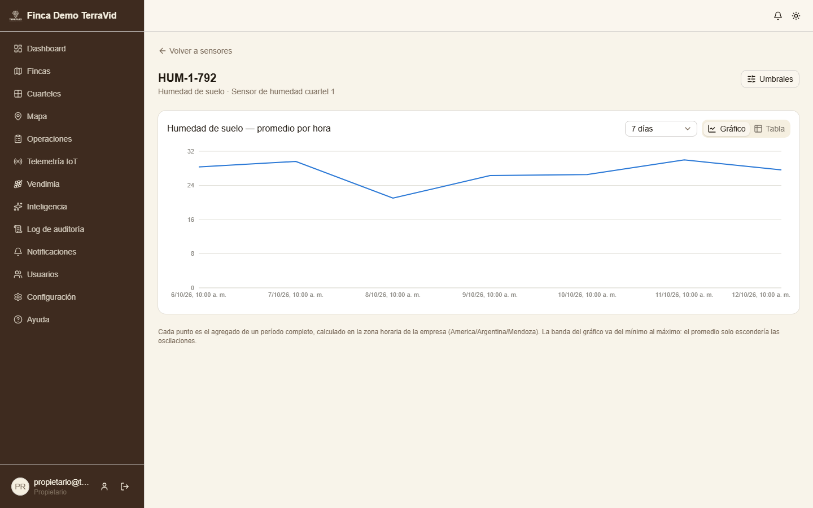

**Exportación:** no.

### 5.7 Inteligencia agronómica

**Dónde:** **Inteligencia** — HU-29, HU-30, HU-31. En las tres pestañas de análisis primero elegís **Finca** y **Cuartel**.

#### Comparar campañas

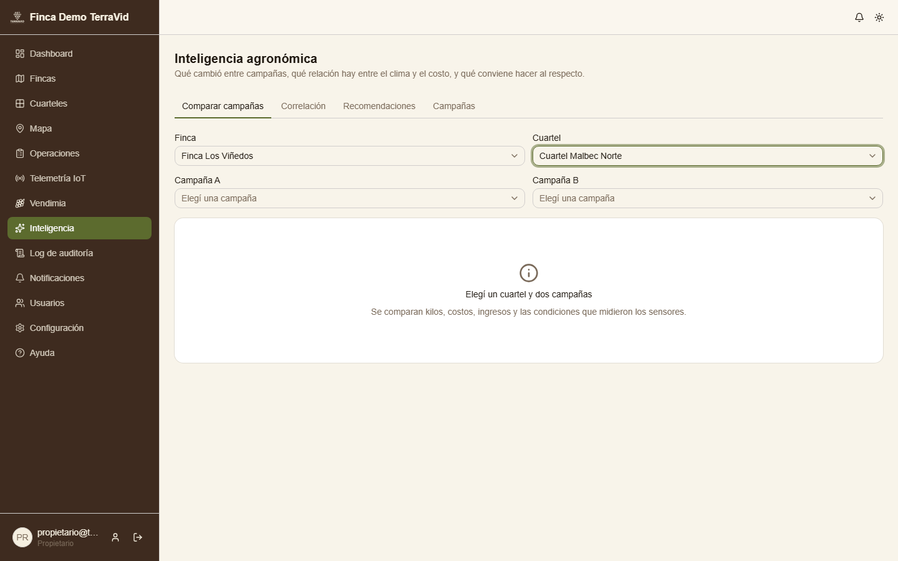

**Qué muestra:** elegí **Campaña A** y **Campaña B**. Se muestra una tabla con cada **Indicador** en las dos campañas y su **Variación**: Kilos cosechados, Costo de labores, Costo de insumos, Costo total, Costo por hectárea, Ingresos y Margen bruto. Debajo, **Condiciones medidas en cada período**: lo que registraron los sensores en cada campaña (promedios; la lluvia como total acumulado).

**Cómo interpretarlo:** si un indicador no se puede comparar porque falta el dato en alguno de los dos períodos, aparece un "—" con el motivo. Necesitás al menos dos campañas cargadas (ver [4.5](#45-campañas-y-metas-de-cosecha)).

#### Correlación sensor–costos

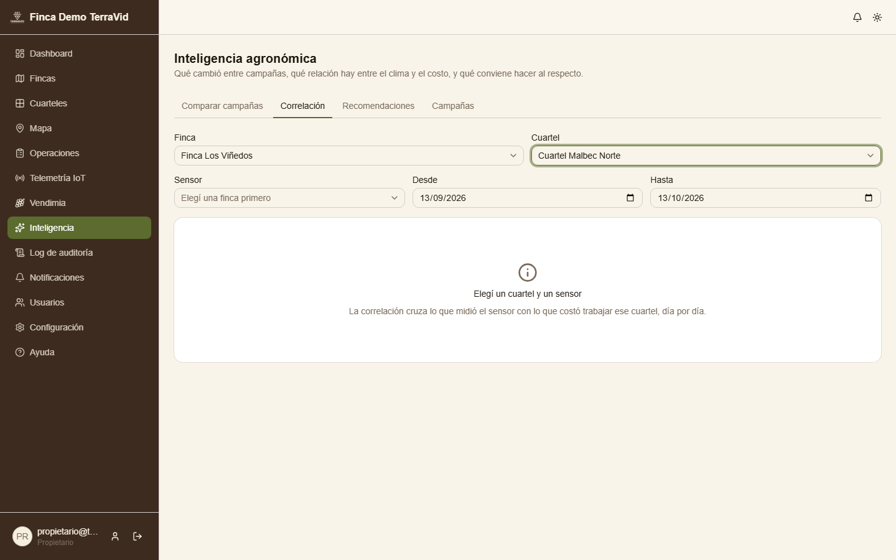

**Qué muestra:** elegí también el **Sensor** y el período (**Desde** / **Hasta**; por defecto, los últimos 30 días). El sistema cruza, día por día, lo que midió el sensor con lo que costó trabajar ese cuartel y muestra:

- El **coeficiente de correlación de Pearson** (un número entre -1 y 1) con su interpretación en palabras.
- Cuántos días con dato en las dos series hubo, contra los necesarios.
- Los dos gráficos: la serie del sensor y el **costo diario del cuartel**.

**Cómo interpretarlo:** cerca de 1, cuando sube la medición sube el costo; cerca de -1, cuando sube una baja el otro; cerca de 0, no hay relación. Si aparece el aviso amarillo de **datos insuficientes**, el número no es concluyente: ampliá el período.

#### Recomendaciones

**Qué muestra:** sugerencias que el sistema genera a partir del histórico de labores, pesajes y telemetría del cuartel (por ejemplo, humedad de suelo baja sostenida). Cada recomendación indica su **severidad** (alta, media o baja), el patrón detectado y la acción sugerida. Necesita **al menos 30 días de datos** del cuartel. Si todavía no los tiene, la pantalla muestra «Todavía no hay histórico suficiente» y cuántos días faltan.

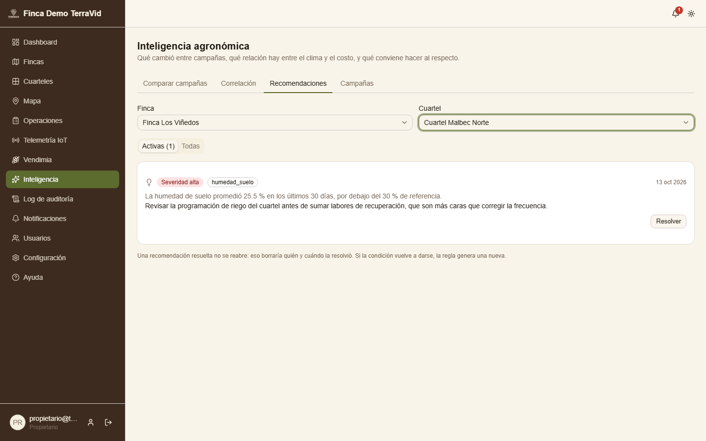

**Cómo usarla:**

1. Pestañas **Activas** y **Todas**.
2. En una recomendación activa, hacé clic en **Resolver**, escribí una **nota** opcional (qué se hizo o por qué no aplica) y elegí **Aplicada** o **Descartar**.

> Una recomendación resuelta no se reabre. Si la condición vuelve a darse, el sistema genera una nueva.

**Exportación (las tres pestañas):** no.

---

## 6. Preguntas frecuentes y solución de problemas

**1. Me equivoqué varias veces la contraseña y ahora dice "Cuenta bloqueada".**
Después de 5 intentos fallidos la cuenta se bloquea 15 minutos. Esperá y volvé a intentar, o usá **Olvidé mi contraseña** para definir una nueva.

**2. No me llega el correo de recuperación (o el de alta de un usuario nuevo).**
Revisá la carpeta de spam. Si no llega, revisá en **Configuración → Correo saliente (SMTP)** que estén cargados el host, el puerto, el usuario, la contraseña y el remitente. Recordá que el enlace de recuperación vence a los 30 minutos y el de alta a las 48 horas.

**3. El dashboard muestra "Registros con error de sync" mayor que cero.**
Hay labores del campo que no se pudieron registrar, casi siempre porque **no había costo vigente** en la fecha de la labor para ese tipo de labor o insumo. Como los costos no se pueden cargar con fecha pasada, no se corrige desde Operaciones: pedí ayuda en **Ayuda → Pedir ayuda** indicando el cuartel y la fecha. Para que no vuelva a pasar, cargá los costos antes de que empiecen los trabajos (ver [4.2](#42-operaciones-insumos-y-tipos-de-labor)).

**4. Un capataz cargó pesajes pero no aparecen en el remito.**
El borrador solo toma los pesajes **sincronizados** del cuartel en la **jornada elegida**. Verificá que el teléfono del capataz se haya sincronizado, que la cuadrilla tuviera **tarifa vigente** en esa fecha y que hayas elegido el día correcto. Si los pesajes estaban en un remito rechazado, quedan **observados** y no entran en uno nuevo.

**5. "Este cuartel ya se encuentra en proceso de liquidación..." al generar un borrador.**
Ese cuartel ya tiene un borrador sin resolver. Aprobalo o rechazalo antes de generar otro.

**6. No puedo dar de baja una finca.**
Primero tenés que dar de baja todos sus cuarteles (Fincas → Cuarteles → "..." → Dar de baja).

**7. El margen bruto aparece como "—".**
Todavía no hay liquidaciones de bodega cargadas para ese cuartel. Cargá la liquidación en el remito aprobado (Vendimia → Remitos → detalle → **Cargar liquidación**).

**8. Una pantalla dice "No se pudieron cargar los datos".**
Hacé clic en **Reintentar**. Si sigue fallando, verificá tu conexión a internet y, si el problema persiste, reportalo en **Ayuda → Pedir ayuda** contando en qué pantalla estabas.

---

## 7. Glosario

| Término | Significado |
|---|---|
| **Finca** | Establecimiento agrícola de la empresa. Tiene ubicación, superficie y, opcionalmente, coordenadas. |
| **Cuartel** | Parcela dentro de una finca, con una variedad y un sistema de conducción. Es la unidad sobre la que se registran labores, pesajes y costos. |
| **Labor** | Trabajo realizado en un cuartel (poda, pulverización, riego…). Se mide en la unidad de su tipo (jornales, horas, hectáreas) y tiene un costo unitario. |
| **Insumo** | Producto que se aplica en una labor (fertilizante, fungicida…), con su unidad y su costo unitario. |
| **Cuadrilla** | Grupo de cosechadores de una finca. Cobra una **tarifa por kilo** cosechado. |
| **Pesaje** | Registro de los kilos que cosechó una cuadrilla en un cuartel en un día. Lo carga el capataz desde la app móvil. |
| **Remito** | Documento que agrupa los pesajes de un cuartel en una jornada para despacharlos a la bodega. Pasa por los estados Borrador, Aprobado o Rechazado. |
| **Liquidación** | Lo que pagó la bodega por un remito aprobado (kilos aceptados × precio, menos descuentos). Es el ingreso del cuartel. |
| **Campaña** | Período agrícola (por ejemplo, 1 de julio a 30 de junio) que se usa para contar la cosecha y comparar temporadas. |
| **Umbral** | Valor mínimo y/o máximo aceptable para la medición de un sensor. Si una lectura sale de ese rango, se genera una alerta. |
| **Vigencia** | Fecha desde la que rige un costo o una tarifa. No puede ser anterior a hoy. |
| **Margen bruto** | Ingresos por liquidaciones menos el costo de labores e insumos de un cuartel. |
