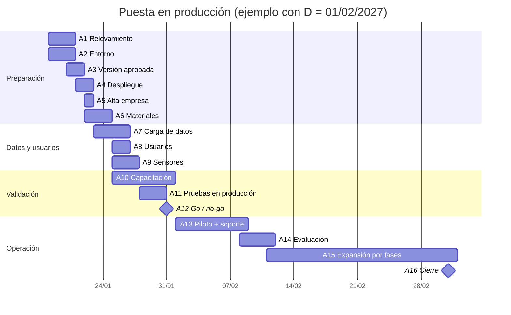

# Plan de implementación — TerraVid

**Proyecto Final — UTN FRM — Etapa 6**
Integrantes: Paula Alvarado (PA) · Sergio Farias (SF)

Este plan es una **base genérica**: sirve para poner TerraVid en marcha en cualquier cliente (finca o bodega) sin cambios de estructura. Lo que varía por cliente —nombre, fincas, cuarteles, cantidad de capataces, sensores— se completa en las tablas de la sección 4. Las referencias técnicas remiten al runbook real del backend (`docs/DESPLIEGUE.md`, Apéndice A) y a `DEPLOYMENT.md` de Mobile.

---

## Introducción: método de implementación

**Método elegido: piloto, seguido de expansión por fases.**

El piloto se hace con **una finca y una cuadrilla durante una vendimia corta** (o un período de labores de 2 a 4 semanas, si la puesta en marcha cae fuera de cosecha). Cumplido el criterio de éxito, se incorporan las demás fincas y cuadrillas de a una por semana.

| Método | Por qué se descarta o se elige |
|---|---|
| Directa | Descartado. La vendimia no admite pausas: si el registro de pesajes falla en todas las fincas a la vez, se pierde la base de la liquidación a los cosechadores. |
| Paralela | Descartado como método general. Exigir al capataz que anote en planilla **y** en la app duplica la carga en el momento de mayor trabajo. Se usa **solo dentro del piloto**, para pesajes: la planilla en papel sigue siendo el respaldo y permite conciliar. |
| **Piloto** | **Elegido.** Acota el riesgo a una finca, prueba en condiciones reales lo que no se puede probar en laboratorio (sin señal en el cuartel, teléfonos de los capataces, sensores a la intemperie) y deja usuarios entrenados que después ayudan a los demás. |
| **Por fases** | **Elegido para la expansión.** Una vez validado el piloto, el sistema es el mismo para todas las fincas (multi-finca dentro de la empresa); solo cambian los datos maestros y los usuarios, así que sumar fincas es de bajo riesgo. |

**Criterio de éxito del piloto (para pasar a la expansión):** 100 % de los pesajes del piloto conciliados con la planilla, sincronización offline sin pérdida de registros, liquidación de la cuadrilla aceptada por el Propietario, ninguna incidencia crítica abierta.

---

## 1. Plan de puesta en producción

D = día de inicio de operaciones del piloto. Responsables: PA (Paula Alvarado), SF (Sergio Farias), PROP (Propietario del cliente), ADM (Administrador de plataforma, rol que cumple el equipo).

| # | Actividad | Responsable | Inicio | Fin | Depende de |
|---|---|---|---|---|---|
| A1 | Relevamiento del cliente: fincas, cuarteles, cuadrillas, insumos, sensores | PA | D-14 | D-12 | — |
| A2 | Verificar entorno de producción (sección 2) | SF | D-14 | D-12 | — |
| A3 | Aprobar versión y etiquetar (sección 3) | SF | D-12 | D-11 | A2 |
| A4 | Desplegar la versión aprobada y verificar componentes | SF | D-11 | D-10 | A3 |
| A5 | Alta de la empresa y del primer Propietario | ADM (SF) | D-10 | D-10 | A4 |
| A6 | Grabar videos y producir la guía rápida del capataz | PA | D-10 | D-8 | A4 |
| A7 | Carga inicial de datos maestros (sección 4) | PA + PROP | D-9 | D-6 | A1, A5 |
| A8 | Alta de usuarios y verificación de accesos (sección 5) | PROP + PA | D-7 | D-6 | A5 |
| A9 | Instalación de sensores y prueba de ingesta | SF | D-7 | D-5 | A7 |
| A10 | Capacitación (`05-plan-capacitacion.md`) | PA + SF | D-7 | D-1 | A6, A8 |
| A11 | Pruebas de validación en producción (sección 6) | SF + PA | D-4 | D-2 | A7, A8, A9 |
| A12 | Decisión de salida (go / no-go) | PA + SF + PROP | D-1 | D-1 | A10, A11 |
| A13 | Inicio de operaciones del piloto y soporte intensivo | PA + SF | D | D+7 | A12 |
| A14 | Evaluación del piloto contra el criterio de éxito | PA + PROP | D+7 | D+10 | A13 |
| A15 | Expansión por fases: una finca más por semana | PA + SF | D+10 | D+30 | A14 |
| A16 | Cierre: informe de implementación y paso a soporte normal | PA + SF | D+30 | D+30 | A15 |

(Fechas de ejemplo con D = lunes 01/02/2027, antes de la vendimia: D-14 es el 18/01 y D+30 el 03/03. Para otro cliente se corre todo el calendario manteniendo los desplazamientos de la tabla.)

---

## 2. Preparar el entorno de producción

La infraestructura es compartida entre clientes (el sistema es multi-empresa: cada consulta filtra por `empresa_id`). Para un cliente nuevo **no se crea infraestructura**: se verifica la existente.

| Componente | Configuración real | Verificación |
|---|---|---|
| Servidor | VM `e2-micro` de Compute Engine (Ubuntu 24.04, `us-central1-a`), IP estática reservada, swap de 2 GB | `free -h`, `df -h`, `docker compose ps` |
| Base de datos | PostgreSQL 16 en contenedor, misma VM; puerto 5432 **cerrado** a internet (se accede por túnel SSH) | Contenedor `terravid-db` *healthy*; `npm run migration:show` todas con `[X]` |
| API | NestJS en contenedor, imagen de Artifact Registry etiquetada por SHA del commit | `curl -i https://terravid-api.duckdns.org/api` → **401** |
| Reverse proxy y TLS | Caddy con certificado Let's Encrypt automático para `terravid-api.duckdns.org` | `openssl s_client` muestra emisor Let's Encrypt y vencimiento vigente |
| Broker MQTT | Mosquitto (perfil `mqtt`), TLS en el puerto 8883 con el certificado de Caddy, credenciales por sensor (D-026) | Regla de firewall `allow-mqtts`; un sensor de prueba publica |
| Web | Firebase Hosting, `https://terravid.web.app` | Responde 200 |
| PWA de campo | Firebase Hosting, `https://terravid-app.web.app` | Se instala y abre sin red |
| APK Android | EAS Build, perfil `production`, firmado siempre con la misma clave | El enlace de descarga del último build funciona |
| Conectividad | Firewall: solo 80, 443 y 8883 abiertos; DNS DuckDNS apuntando a la IP reservada | `nslookup terravid-api.duckdns.org 8.8.8.8` |
| Seguridad | La API usa el rol acotado `terravid_app` (sin DDL, D-017); secretos en `.env.app` con permisos 600; `CORS_ORIGIN` = Web + PWA; contraseñas iniciales obligadas a cambiarse | `npm run db:verificar-privilegios`; `grep CORS_ORIGIN .env.app` |
| Accesos del equipo | SSH a la VM por `gcloud compute ssh` (Owner del proyecto `terravid`); contraseñas de `postgres` y `terravid_app` en el gestor compartido | Ambos integrantes entran a la VM y a la consola de Firebase |
| Backups | `backup-db.sh` diario a las 7 UTC hacia `gs://terravid-backups`, retención 30 días | Existe el archivo del día; **una restauración probada** en base descartable (DESPLIEGUE A.10) |
| Monitoreo | Timer `terravid-deploy`, alertas de presupuesto (50/90/100 %), tabla *Qué vigilar* (DESPLIEGUE A.12) | `systemctl list-timers terravid-deploy.timer`; no existe `/var/lib/terravid/imagen-fallida` |

---

## 3. Despliegue

**Versión aprobada.** Es un commit de `main` de cada repositorio (Backend, Web, Mobile) que pasó el CI en verde y la revisión del otro integrante. Se marca con un tag anotado, igual en los tres repositorios: `git tag -a vX.Y.Z -m "Versión aprobada para <cliente>"` y `git push origin vX.Y.Z`. El tag permite saber exactamente qué corre; la imagen del backend queda además identificada por el SHA corto del mismo commit.

| Paso | Backend (API) | Web | PWA / APK |
|---|---|---|---|
| 1. Disparo | Merge a `main` | Merge a `main` | Merge a `main` (PWA); `eas build --platform android --profile production` (APK) |
| 2. CI | `desplegar.yml`: tipos, lint, tests unitarios; smoke (185 casos) y e2e contra Postgres real; cobertura ≥ 70 % | `deploy.yml`: lint, tests, build con `VITE_API_URL` | `deploy-mobile.yml`: `tsc`, Jest, `expo export` |
| 3. Publicación | Imagen a Artifact Registry con etiquetas `<sha>` y `main` (Workload Identity, sin claves) | Firebase Hosting `terravid` | Firebase Hosting `terravid-app`; APK en EAS |
| 4. Puesta en marcha | La VM revisa `origin/main` cada 2 min (`actualizar.sh`): baja la imagen del SHA, corre migraciones, reaplica privilegios de `terravid_app`, recrea la API | Inmediata | Inmediata (PWA); los capataces instalan el APK nuevo encima |
| 5. Verificación automática | La API debe responder en 90 s; si no, vuelve sola a la imagen anterior | `curl -I -f https://terravid.web.app` | Health check del sitio |

**Verificación manual de componentes** (la registra SF en la planilla de despliegue):

- [ ] `journalctl -u terravid-deploy -n 40` muestra el SHA del tag y ninguna reversión.
- [ ] `GET /api` → 401; login con un usuario real devuelve sesión.
- [ ] `docker compose -f docker-compose.prod.yml ps`: `api`, `db`, `caddy` y `mqtt` en ejecución.
- [ ] Web y PWA cargan la versión nueva (forzar recarga).
- [ ] El APK instalado muestra el número de versión de `app.json`.

---

## 4. Carga inicial de datos

Los datos se cargan **por la Web**, con los usuarios del cliente y en este orden, porque cada paso depende del anterior. La creación de la empresa ya siembra los catálogos por defecto (variedades, sistemas de conducción, unidades de medida, estados de cuartel).

| Orden | Dato maestro | Quién lo carga | Dónde | Datos mínimos |
|---|---|---|---|---|
| 1 | Empresa y primer Propietario | Administrador de plataforma | Web → *Empresas* (`POST /api/empresas`) | Nombre, CUIT, nombre y correo del Propietario |
| 2 | Configuración general | Propietario | Web → *Configuración* (HU-33) | Nombre de la organización, zona horaria, moneda, correo de soporte, SMTP |
| 3 | Catálogos propios | Propietario | Web → *Tablas maestras* (HU-34) | Variedades y sistemas de conducción que falten |
| 4 | Fincas | Propietario | Web → *Fincas* (HU-08) | Nombre, ubicación, hectáreas |
| 5 | Cuarteles con ubicación | Propietario o Agrónomo | Web → *Cuarteles* (HU-09); se verifican en el mapa (HU-10) | Finca, variedad, conducción, hectáreas, año de implantación, latitud y longitud del centroide |
| 6 | Tipos de labor e insumos | Propietario o Agrónomo | Web → *Labores e insumos* (HU-16) | Nombre, unidad, costo unitario |
| 7 | Campaña y metas de cosecha | Propietario | Web → *Campañas* (HU-31, D-027) | Rango de fechas (el seed propone 1 de julio a 30 de junio); meta en kg por cuartel |
| 8 | Cuadrillas | Propietario o Agrónomo (tarifa: solo Propietario) | Web → *Cuadrillas* (HU-23) | Finca, nombre, cantidad de integrantes, tarifa por kg con fecha de vigencia |
| 9 | Sensores y umbrales | Propietario o Agrónomo | Web → *Sensores* (HU-18, HU-21) | Código, tipo, finca asociada, umbrales de temperatura y humedad; credencial MQTT generada y cargada en el nodo |

**Validación de integridad.**

| Control | Cómo | Criterio |
|---|---|---|
| Totales contra el relevamiento | Contar fincas, cuarteles, hectáreas y cuadrillas en la Web y comparar con la planilla del cliente (A1) | Coinciden 100 % |
| Ubicación de cuarteles | Mapa de cuarteles (HU-10) | Cada marcador cae en la posición real del cuartel (contraste con imagen satelital o GPS del relevamiento) |
| Referencias completas | El sistema exige finca, variedad y conducción al crear un cuartel; se revisa que no queden cuarteles sin superficie | Ninguno con hectáreas vacías |
| Campaña vigente | Dashboard muestra la campaña actual y el avance de cosecha con metas | Sin "campaña: null" |
| Sensores | Gráfico del sensor (HU-20) con lecturas de las últimas horas | Al menos una lectura por sensor |
| Trazabilidad | Log de auditoría (HU-07) registra cada alta | Una entrada por dato cargado |

Firma de conformidad: el Propietario revisa los totales y da el visto bueno antes de A10.

---

## 5. Usuarios, perfiles y permisos

**Secuencia de alta:** Administrador de plataforma → crea la empresa y su primer Propietario (recibe contraseña temporal por correo; el Administrador nunca la conoce) → el Propietario da de alta Agrónomos, Capataces y Auditor y los asigna a fincas → cada usuario entra obligado a cambiar la contraseña. Un Propietario no puede crear Administradores (D-025).

**Matriz rol / permiso** (resumen de `src/common/permisos/permisos.ts`, que es la única tabla del sistema y viaja con la sesión a la Web y a la app; ✔ = puede, L = solo lectura, — = no accede).

| Funcionalidad | Administrador | Propietario | Agrónomo | Capataz | Auditor |
|---|---|---|---|---|---|
| Empresas cliente | ✔ | — | — | — | — |
| Perfil propio | ✔ | ✔ | ✔ | ✔ | ✔ |
| Dashboard, notificaciones, ayuda, campañas | — | ✔ | ✔ | ✔ | ✔ |
| Usuarios, roles, configuración, catálogos | — | ✔ | — | — | — |
| Log de auditoría | — | ✔ | — | — | L |
| Fincas | — | ✔ | L | L | L |
| Cuarteles | — | ✔ | ✔ (sin baja) | L | L |
| Tipos de labor e insumos (con costos) | — | ✔ | ✔ (sin baja) | L | — |
| Registrar labores | — | ✔ | ✔ | ✔ | — |
| Historial de labores | — | ✔ | ✔ | ✔ | L |
| Telemetría y sensores | — | ✔ | ✔ | — | — |
| Pesajes y remitos (registro, borrador) | — | ✔ | ✔ | ✔ | — |
| Aprobar, rechazar y liquidar remitos | — | ✔ | ✔ | — | — |
| Cuadrillas | — | ✔ | ✔ | Alta y consulta | — |
| Tarifas de cuadrilla | — | ✔ | — | — | — |
| Inteligencia agronómica | — | ✔ | ✔ | — | — |
| App móvil de campo | — | ✔ | ✔ | ✔ | — |

**Verificación de accesos:** con cada usuario creado se inicia sesión una vez y se comprueba (a) que el menú muestra solo lo de su rol, (b) que una acción fuera de su rol responde 403 (p. ej., el Capataz no ve *Telemetría*; el Auditor no ve costos), (c) que el Auditor y el Administrador no pueden entrar a la app móvil. Lo registra PA en la planilla de accesos.

---

## 6. Pruebas de validación en producción

Se ejecutan en D-4 a D-2 con datos reales del cliente. Los registros de prueba se marcan con la observación "PRUEBA" y se anulan al terminar.

| ID | Caso crítico | Rol | Resultado esperado | Responsable |
|---|---|---|---|---|
| PV-01 | Login de un usuario de cada rol (Web, y app para los que corresponde) | Todos | Sesión válida; menú acorde a la matriz; Auditor rechazado en la app | PA |
| PV-02 | Registrar una labor con insumo **en modo avión**, recuperar señal | Capataz | El registro queda pendiente y se sincroniza solo; aparece en el historial del cuartel en la Web | PA |
| PV-03 | Registrar pesajes de la cuadrilla (offline y online) | Capataz | Kilos visibles en la Web; avance de cosecha actualizado; liquidación calculada con la tarifa | PA |
| PV-04 | Generar borrador de remito y aprobarlo | Agrónomo / Propietario | Remito aprobado; estado del cuartel actualizado (HU-28) | SF |
| PV-05 | Ingesta de sensor por MQTT (y por HTTP con `X-Api-Key`) | — | Lectura visible en el gráfico; sin clave, la ingesta HTTP se rechaza | SF |
| PV-06 | Superar un umbral configurado | Agrónomo | Alerta y notificación generadas | SF |
| PV-07 | KPI del dashboard: margen bruto y avance de campaña | Propietario | Valores coinciden con el cálculo manual de los datos de prueba | PA |
| PV-08 | Recuperación de contraseña por correo | Cualquiera | Llega el correo con enlace a `https://terravid.web.app` | SF |
| PV-09 | Backup del día y restauración en base descartable | — | Restauración completa sin errores | SF |

**Registro de incidencias.** Cada falla se anota en el tablero de *issues* del repositorio correspondiente con: ID del caso, fecha y hora, rol y dispositivo, pasos, resultado obtenido, severidad y responsable.

| Severidad | Definición | Tiempo de respuesta |
|---|---|---|
| Crítica | Impide registrar labores o pesajes, o pierde datos | Inmediata; bloquea el *go* |
| Alta | Una funcionalidad no anda pero hay alternativa (p. ej., planilla) | Antes de D |
| Media / baja | Error visual o de usabilidad | Se planifica |

---

## 7. Comunicación e inicio de operaciones

| Momento | Aviso | Canal | Responsable |
|---|---|---|---|
| D-7 | Cronograma, accesos y materiales de capacitación | Correo del sistema + mensaje al Propietario | PA |
| D-1 | Resultado del go/no-go y fecha confirmada de inicio | Reunión breve + correo | PA |
| D (mañana) | "TerraVid en operación en la finca piloto": a quién llamar y qué hacer si no hay señal | Grupo de mensajería con capataces y Agrónomo; guía rápida impresa | PA |
| D+1 a D+7 | Resumen diario de registros sincronizados e incidencias | Correo al Propietario | SF |
| D+10 | Resultado del piloto y calendario de expansión | Reunión con el Propietario | PA + SF |

**Soporte en los primeros días.**

| Período | Canal | Horario | Atiende |
|---|---|---|---|
| D a D+7 | Presencia en finca (día 1 y 2) + grupo de mensajería + teléfono | 7 a 19 h, todos los días de cosecha | PA (usuarios y operación), SF (técnico) |
| D+8 a D+30 | Ticket del Centro de Ayuda (HU-36) + grupo de mensajería | Días hábiles, 8 a 18 h | Por turno semanal PA / SF |
| Desde D+30 | Ticket del Centro de Ayuda | Días hábiles | Soporte normal |

---

## 8. Plan de contingencia

**Fallas previstas.**

| Falla | Acción inmediata | Responsable |
|---|---|---|
| Sin señal en el cuartel | Nada: la app trabaja offline y sincroniza al volver la red | Capataz |
| API caída o inaccesible | Los capataces siguen registrando offline; revisar `docker compose ps`, logs de `api` y `caddy`; si es una versión nueva, rollback (abajo) | SF |
| Despliegue fallido | `actualizar.sh` revierte solo en 90 s; revisar `/var/lib/terravid/imagen-fallida` | SF |
| Teléfono roto o perdido con registros sin sincronizar | Si hay respaldo (*Ajustes → Respaldo*), restaurarlo en otro teléfono; si no, cargar desde la planilla de respaldo | PA |
| Sensor sin reportar | Verificar alimentación y red del nodo; regenerar credencial MQTT desde la Web | SF |
| Datos corruptos o borrado masivo | Detener el timer de despliegue y restaurar el último backup (abajo) | SF |
| DuckDNS o VM fuera de servicio | Operación offline; repuntar DNS o recrear la VM según DESPLIEGUE A.4–A.9 | SF |

**Escalamiento.**

| Nivel | Quién | Cuándo escala |
|---|---|---|
| 1 | Capataz / Agrónomo → PA | Duda de uso o registro que no sincroniza |
| 2 | PA → SF | Falla técnica confirmada, o más de 30 min sin solución |
| 3 | SF + PA → Propietario | Falla crítica: decisión de rollback o de volver a planilla |

**Criterios objetivos de rollback** (basta uno):

1. La API no responde (`GET /api` distinto de 401) durante más de 15 minutos después de un despliegue.
2. Una incidencia crítica de la sección 6 aparece en producción y no tiene corrección en 2 horas.
3. Se detecta pérdida o duplicación de pesajes o labores sincronizados.
4. Más del 20 % de los registros de un día quedan sin sincronizar teniendo señal.

**Procedimiento de rollback** (DESPLIEGUE A.11, *Volver atrás*):

| Componente | Procedimiento |
|---|---|
| API | Automático si no arranca. A mano, a la imagen del tag anterior: `docker compose -f docker-compose.prod.yml down api` y `API_IMAGE=us-central1-docker.pkg.dev/terravid/terravid/api:<sha> docker compose -f docker-compose.prod.yml up -d api`. Para que no vuelva a traer `main`: `sudo systemctl stop terravid-deploy.timer`, y luego revertir el merge en `main`. |
| Base de datos | **Las migraciones no se revierten**: el rollback restituye el código, no el esquema. Si la versión trajo migraciones incompatibles o hubo daño de datos, restaurar el `pg_dump` más reciente de `gs://terravid-backups/postgres/` (DESPLIEGUE A.10), primero en base descartable para validar y luego sobre la base productiva con la API detenida. Se pierden los datos posteriores al backup (hasta 24 h): se recuperan resincronizando desde los teléfonos y la planilla de respaldo. |
| Web y PWA | Firebase Hosting → historial de versiones → revertir a la versión anterior; o revertir el merge en `main`, que vuelve a desplegar. |
| APK | Android no instala una versión con `versionCode` menor: se genera un build nuevo desde el tag anterior (EAS sube el `versionCode`) y se distribuye el enlace. Mientras tanto, la PWA sirve de alternativa. |
| Operación | Si nada de lo anterior se resuelve en el día, el piloto vuelve a planilla en papel y los datos se cargan después; la decisión la toma el Propietario con el equipo (nivel 3). |

Toda reversión se registra como incidencia con causa, acción y tiempo de recuperación, y se revisa en la evaluación del piloto (A14).
