# Planificación, ejecución y documentación de pruebas — TerraVid

**Proyecto Final · Etapa 6 — Desarrollo e Implementación**
Integrantes: Paula Alvarado · Sergio Farias
Fecha de ejecución: 13/10/2026

---

## 1. Planificación

### 1.1 Objetivo

Verificar con 9 pruebas documentadas que las historias de usuario críticas del modelo funcional funcionan de punta a punta y que el control de acceso por rol (módulos transversales) bloquea lo que debe bloquear, tanto en pantalla como en el backend.

### 1.2 Distribución exigida y selección

| Tipo | Cant. | Pruebas | Criterio de selección |
|---|---:|---|---|
| Funcional | 4 | PRU-01 a PRU-04 | Una por cada HU crítica: el acceso (HU-01), el dato maestro del que depende todo lo demás (HU-08) y las dos operaciones de campo que son el núcleo del negocio (HU-12 labores, HU-24 pesajes). |
| Integración | 2 | PRU-05, PRU-06 | Los dos flujos que cruzan más módulos: app móvil → sincronización → backend → historial y costeo en la Web; y sensor IoT → ingesta → umbral → alerta → dashboard y notificación. |
| Seguridad y control de acceso | 3 | PRU-07 a PRU-09 | Un rol sin permiso intenta: entrar a una pantalla restringida (Web), ejecutar acciones restringidas directo contra la API, e ingresar a un cliente que su rol no tiene habilitado (app móvil). |

### 1.3 Entorno de prueba

| Componente | Dónde corrió | Versión |
|---|---|---|
| API NestJS | `http://localhost:3000/api` (build de `main`, `node dist/main.js`) | commit `6f5a698` |
| Base de datos | PostgreSQL 16 + PostGIS en Docker, base limpia `terravid_demo` creada para la prueba (migraciones + seed) | — |
| Web | `http://localhost:5173` (Vite) | commit `76a75c9` |
| App móvil | Exportación web (PWA) de la app Expo en `http://localhost:8081`, viewport de teléfono 412×915, GPS simulado (-33.0362, -68.8833) | commit `b2ec07d` |
| Navegador | Chromium 1243 vía Playwright (automatiza los pasos y toma las capturas) | — |

Se usó una base aislada para no tocar los datos de producción ni la base de desarrollo, y para que cada evidencia sea reproducible.

### 1.4 Datos de prueba

- **Empresa** "Finca Demo TerraVid", con la campaña 2026/2027 creada por el seed.
- **Usuarios**, todos con la contraseña `Terravid123!`:

  | Usuario | Rol |
  |---|---|
  | `propietario@terravid.demo` | Propietario |
  | `capataz@terravid.demo` | Capataz |
  | `auditor@terravid.demo` | Auditor |
  | `agronomo@terravid.demo` | Agrónomo |

- **Finca "Los Viñedos"** (Luján de Cuyo, 150 ha), con tres cuarteles:
  - Malbec Norte: 25 ha
  - Malbec Sur: 30 ha
  - Cabernet Este: 20 ha
- **Tipos de labor** con costo vigente: Poda ($15.000/jornal), Pulverización y Riego por Goteo.

- **Insumos** Fertilizante NPK y Fungicida Azufre, más 18 labores históricas.
- **Cosecha:** "Cuadrilla Norte (Cosechadores)" con una tarifa de $150/kg, 10 pesajes y un remito borrador.
- **Sensores:** 3 sensores de humedad (HUM-1-792, HUM-2-478, HUM-3-744) con 30 días de lecturas.

### 1.5 Criterios

- **Entrada:** la API responde, la base está migrada y sembrada, y las suites automáticas están en verde (ver §4).
- **Aprobada:** el resultado obtenido coincide con el esperado, que sale de los criterios de aceptación de la HU, y hay captura que lo muestra.
- **Fallida:** cualquier diferencia. Se registra el defecto, se corrige y la prueba se re-ejecuta (estado *Re-ejecutada*).
- **Salida:** las 9 pruebas quedan Aprobadas o Re-ejecutadas y aprobadas.

### 1.6 Responsables y cronograma

| Actividad | Responsable | Fecha |
|---|---|---|
| Selección de HU y diseño de casos | Paula Alvarado | 13/10/2026 |
| Preparación del entorno y de los datos | Sergio Farias | 13/10/2026 |
| Ejecución PRU-01 a PRU-05 | Paula Alvarado | 13/10/2026 |
| Ejecución PRU-06 a PRU-09 | Sergio Farias | 13/10/2026 |
| Revisión cruzada de evidencias e informe | Ambos | 13/10/2026 |

---

## 2. Resumen de ejecución

| ID | Tipo | HU | Pantalla | Estado |
|---|---|---|---|---|
| PRU-01 | Funcional | HU-01 Iniciar sesión | PAN-01 | ✅ Aprobada |
| PRU-02 | Funcional | HU-08 ABM fincas | PAN-07 | ✅ Aprobada |
| PRU-03 | Funcional | HU-12 Registrar labor | PAN-09 | ✅ Aprobada |
| PRU-04 | Funcional | HU-24 Registro de pesaje | PAN-12 | ✅ Aprobada |
| PRU-05 | Integración | HU-12 + HU-14 + HU-17 + HU-15 | PAN-09 → PAN-05 → historial y PAN-15 | ✅ Aprobada |
| PRU-06 | Integración | HU-19 + HU-21 + HU-22 + HU-20 | PAN-11, PAN-17 | ✅ Aprobada |
| PRU-07 | Seguridad | HU-05 / permisos por rol | PAN-04 | ✅ Aprobada |
| PRU-08 | Seguridad | HU-05, HU-08, HU-07 (backend) | API | ✅ Aprobada |
| PRU-09 | Seguridad | HU-01 (acceso a la app móvil por permiso) | PAN-01 móvil | ✅ Aprobada |

**9 de 9 aprobadas.**

Durante la puesta a punto del entorno aparecieron dos cosas, documentadas en §5:
- un comportamiento esperado que conviene explicar al usuario;
- un riesgo de dependencias.

Ninguna invalida las pruebas.

---

## 3. Fichas de prueba

### PRU-01 — Iniciar sesión (funcional)

| Campo | Contenido |
|---|---|
| ID de prueba | PRU-01 |
| CU/HU referenciado | HU-01 — Iniciar sesión |
| Pantalla / Reporte | PAN-01 — Login / Inicio de Sesión (Web `/login`) |
| Datos de entrada | 1) `propietario@terravid.demo` / `ClaveIncorrecta1`. 2) `propietario@terravid.demo` / `Terravid123!` |
| Pasos | 1. Abrir `/login`. 2. Ingresar el email y la contraseña incorrecta y presionar «Iniciar sesión». 3. Reemplazar la contraseña por la correcta y presionar «Iniciar sesión». |
| Resultado esperado | Con la contraseña incorrecta: mensaje genérico «Email o contraseña incorrectos», sin indicar qué campo falló, y el usuario sigue en el login. Con la correcta: ingresa y ve el dashboard de su rol. |
| Resultado obtenido | Con la contraseña incorrecta se mostró «Email o contraseña incorrectos» y no se salió del login. Con la correcta redirigió a `/` (Dashboard), donde figura «Sesión: propietario@terravid.demo (Propietario)». |
| Estado | **Aprobada** |
| Evidencia | 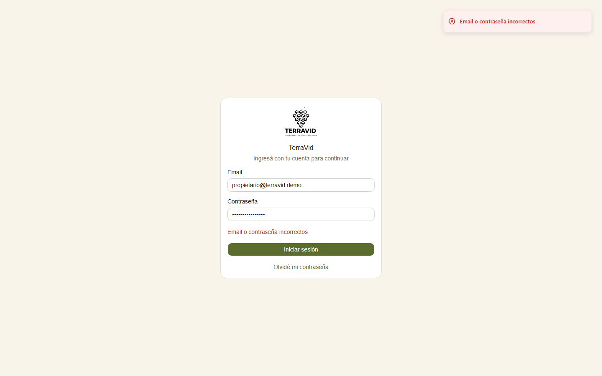 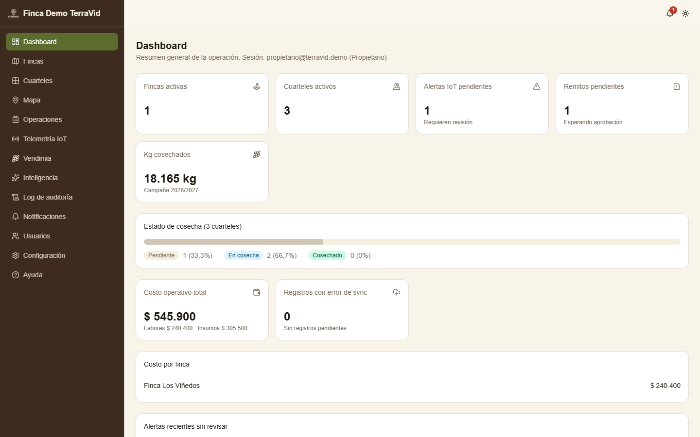 |

### PRU-02 — Alta de finca (funcional)

| Campo | Contenido |
|---|---|
| ID de prueba | PRU-02 |
| CU/HU referenciado | HU-08 — ABM fincas |
| Pantalla / Reporte | PAN-07 — ABM de Fincas (Web `/fincas`) |
| Datos de entrada | Nombre «Finca El Algarrobo», Ubicación «Tupungato, Mendoza», Hectáreas 42, Latitud -33.3710, Longitud -69.1470 |
| Pasos | 1. Ingresar como Propietario. 2. Menú **Fincas** → «Nueva finca». 3. Completar el formulario. 4. Presionar «Crear finca». |
| Resultado esperado | Se cierra el diálogo, la finca aparece en el listado con sus hectáreas y queda disponible para cargarle cuarteles. |
| Resultado obtenido | La finca «Finca El Algarrobo» aparece en el listado junto a «Finca Los Viñedos». También aparece de inmediato en el selector de fincas de la app móvil (visible en PRU-03). |
| Estado | **Aprobada** |
| Evidencia | 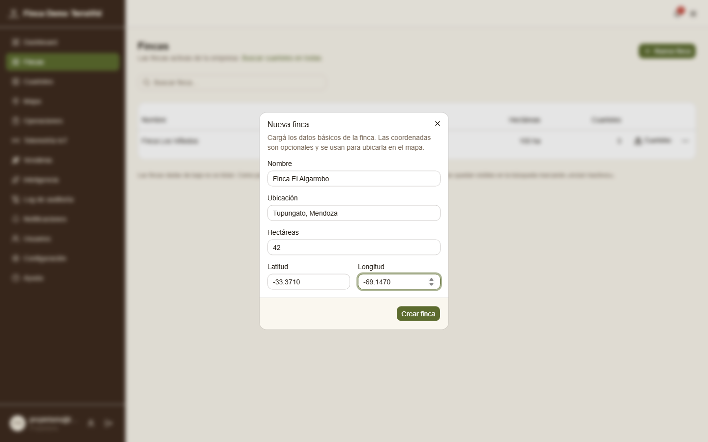 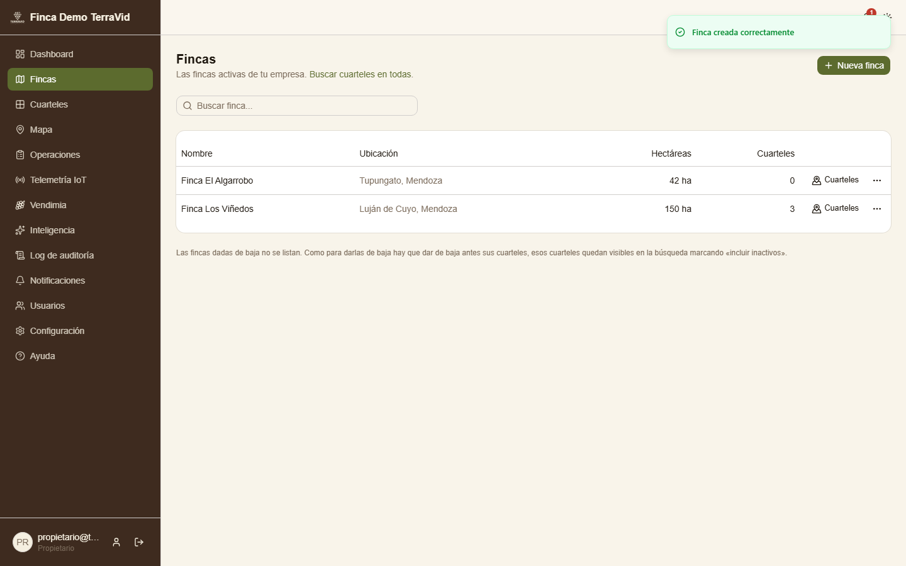 |

### PRU-03 — Registrar labor desde la app móvil (funcional)

| Campo | Contenido |
|---|---|
| ID de prueba | PRU-03 |
| CU/HU referenciado | HU-12 — Registrar labor realizada |
| Pantalla / Reporte | PAN-09 — Carga de Labores (Mobile) |
| Datos de entrada | Usuario `capataz@terravid.demo`; Finca Los Viñedos; Cuartel Malbec Sur; Labor Poda; Cantidad 3 (jornales); fecha de hoy (propuesta por la app); GPS -33.0362, -68.8833 |
| Pasos | 1. Ingresar a la app como Capataz. 2. Pestaña **Labores** → botón «+». 3. Elegir finca, cuartel y tipo de labor. 4. Cargar la cantidad. 5. Presionar «Guardar (Local)». |
| Resultado esperado | La labor se guarda primero en el teléfono, se informa al usuario y se sincroniza sola con el servidor con estado *sincronizado*, guardando la ubicación GPS y el costo vigente a esa fecha. |
| Resultado obtenido | La app mostró «Labor guardada. El registro se guardó en el teléfono y se sincroniza automáticamente.» En el servidor quedó el registro Poda · Malbec Sur · 3,00 · estado `sincronizado` · lat -33.0362 / long -68.8833 · costo unitario $15.000. |
| Estado | **Aprobada** |
| Evidencia | 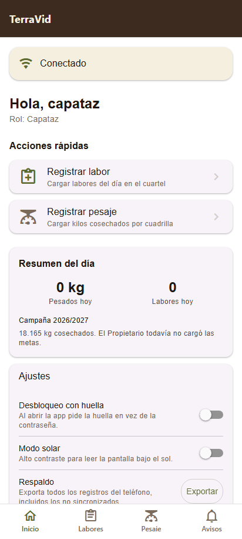 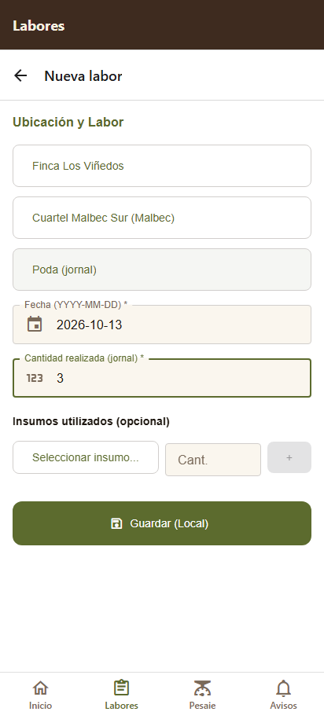  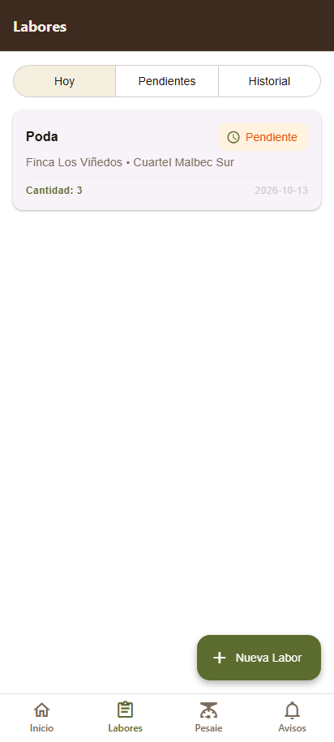 |

### PRU-04 — Registrar pesaje de vendimia desde la app móvil (funcional)

| Campo | Contenido |
|---|---|
| ID de prueba | PRU-04 |
| CU/HU referenciado | HU-24 — Registro de pesaje diario |
| Pantalla / Reporte | PAN-12 — Consola de Pesaje de Vendimia (Mobile) |
| Datos de entrada | Usuario `capataz@terravid.demo`; Finca Los Viñedos; Cuadrilla Norte (Cosechadores); Cuartel Malbec Sur; 1.250 kg |
| Pasos | 1. Ingresar como Capataz. 2. Pestaña **Pesaje** → botón «+». 3. Elegir finca, cuadrilla y cuartel. 4. Cargar los kg. 5. Presionar «Guardar». |
| Resultado esperado | El pesaje se guarda en el teléfono y se sincroniza. El servidor calcula la liquidación con la tarifa vigente de la cuadrilla y lo deja en estado *pendiente de remito*. |
| Resultado obtenido | La app mostró «Pesaje guardado. El pesaje se guardó en el teléfono y se sincroniza automáticamente.» En el servidor quedó 1.250 kg · Malbec Sur · monto de liquidación $187.500 (1.250 × $150) · `sincronizado` · `pendiente_remito` · con GPS. |
| Estado | **Aprobada** |
| Evidencia | 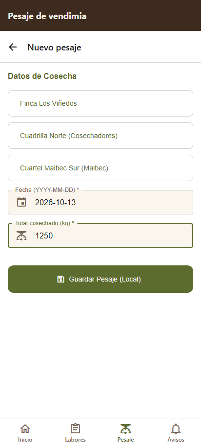  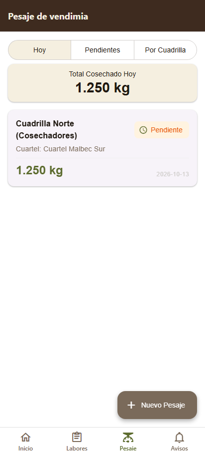 |

### PRU-05 — Labor de campo visible en historial y costeo de la Web (integración)

| Campo | Contenido |
|---|---|
| ID de prueba | PRU-05 |
| CU/HU referenciado | HU-12 (registro) + HU-14 (sincronización offline) + HU-17 (historial por cuartel) + HU-15 (costeo y margen) |
| Pantalla / Reporte | PAN-09 (Mobile) → PAN-05 (sincronización) → Web `/cuarteles/:id/historial`, `/operaciones` (PAN-15), `/cuarteles/:id/pesajes` |
| Datos de entrada | La labor y el pesaje cargados en PRU-03 y PRU-04 (cuartel Malbec Sur). Antes de la prueba Malbec Sur no tenía ninguna labor de Poda. |
| Pasos | 1. Ejecutar PRU-03 y PRU-04 en la app. 2. Sin intervención manual, ingresar a la Web como Propietario. 3. Abrir Cuarteles → Malbec Sur → Historial. 4. Abrir Operaciones → Costeo. 5. Abrir los pesajes de Malbec Sur. |
| Resultado esperado | Lo registrado en el campo aparece en la Web sin recarga manual de datos: la Poda en el historial con su costo ($15.000 × 3 = $45.000), el costo del cuartel sumado en el costeo y el pesaje de 1.250 kg en la lista de pesajes. |
| Resultado obtenido | El historial de Malbec Sur muestra la Poda del 13/10/2026 (3 jornales, responsable Capataz, con ubicación). El costeo incluye ese costo en la fila de Malbec Sur y el pesaje de 1.250 kg figura en la lista del cuartel. |
| Estado | **Aprobada** |
| Evidencia | 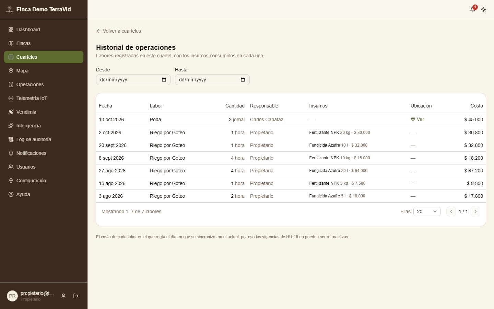 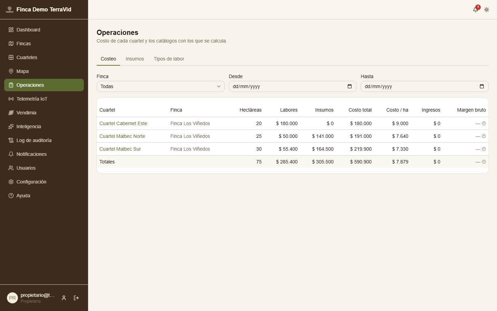 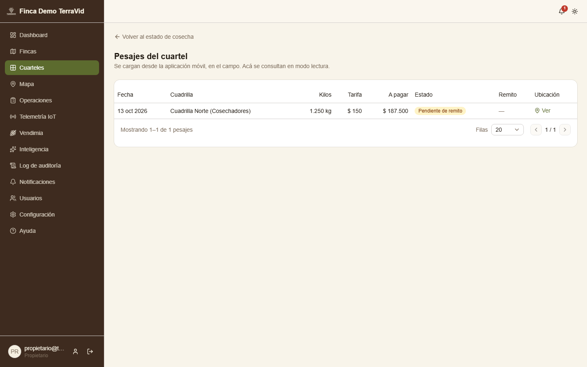 |

### PRU-06 — Lectura de sensor fuera de umbral genera alerta (integración)

| Campo | Contenido |
|---|---|
| ID de prueba | PRU-06 |
| CU/HU referenciado | HU-19 (ingesta) + HU-21 (umbrales) + HU-22 (notificación) + HU-20 (gráficos) |
| Pantalla / Reporte | PAN-11 — Dispositivos IoT; PAN-17 — Gráficos de Telemetría y Umbrales; Dashboard |
| Datos de entrada | Sensor HUM-1-792 con umbral mínimo 20 y máximo 45. Lectura enviada como lo hace el nodo IoT por el canal HTTP de respaldo: `POST /api/lecturas-iot` con header `X-Api-Key`, cuerpo `{codigoSensor: "HUM-1-792", valor: 61.5, unidad: "%"}` |
| Pasos | 1. Configurar el umbral del sensor (20–45). 2. Ver el dashboard. 3. Enviar la lectura de 61,5 %. 4. Recargar el dashboard. 5. Abrir Telemetría IoT → Alertas. 6. Abrir la serie del sensor y las Notificaciones. |
| Resultado esperado | La lectura se acepta y se guarda. Como supera el máximo se genera una alerta pendiente, aumenta el contador «Alertas IoT pendientes» del dashboard, el Propietario recibe una notificación y la lectura aparece en el gráfico del sensor. |
| Resultado obtenido | La API respondió `201 {"estado":"aceptada"}`. En Alertas aparece «Superó el máximo · HUM-1-792 · Finca Los Viñedos · Midió 61,5 contra un umbral de 45». El contador del dashboard pasó a 1 («Requieren revisión»), la campana muestra 1 notificación y la serie del sensor incluye el pico. |
| Estado | **Aprobada** |
| Evidencia | 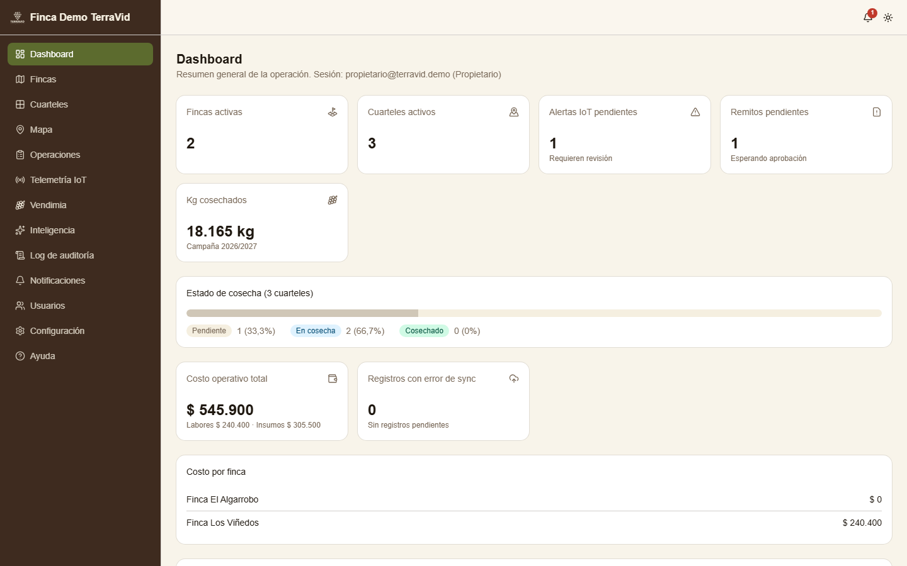  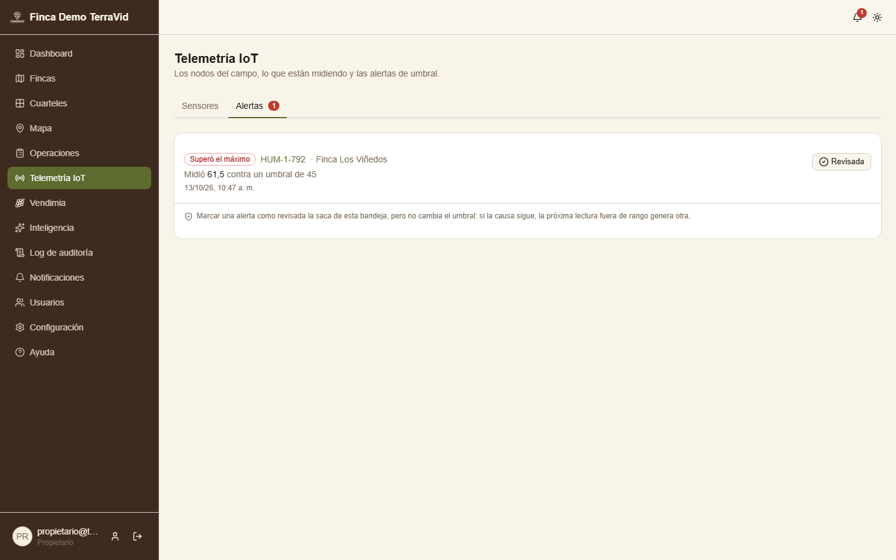 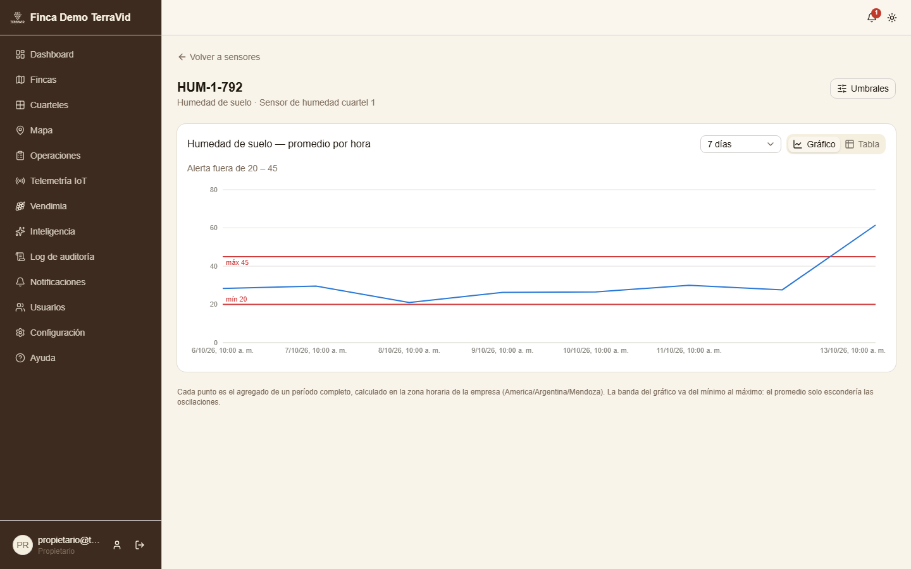 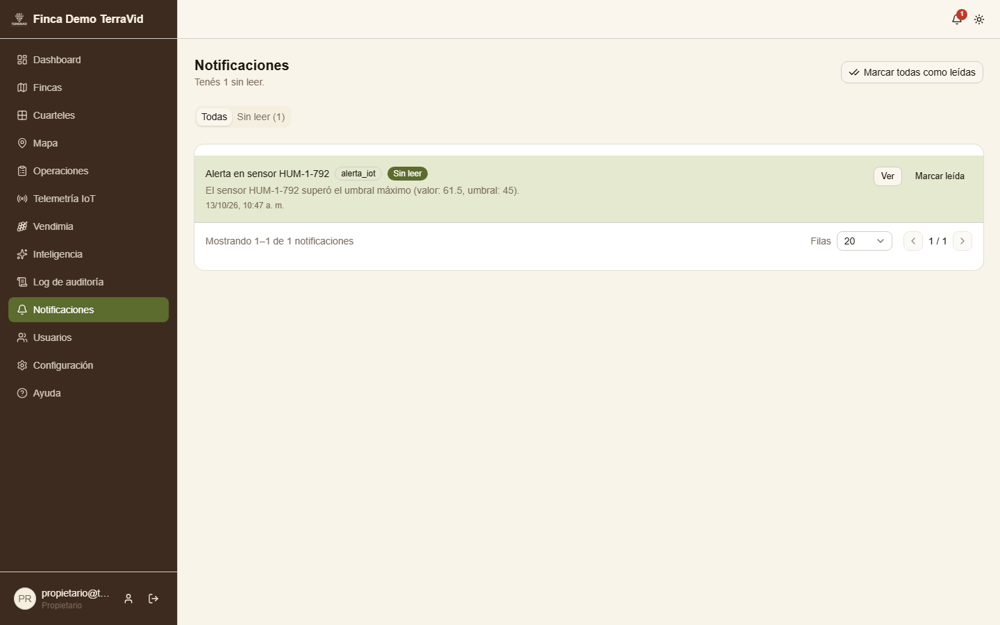 |

### PRU-07 — Capataz no puede entrar a la administración de usuarios (seguridad · pantalla)

| Campo | Contenido |
|---|---|
| ID de prueba | PRU-07 |
| CU/HU referenciado | HU-05 — ABM Usuarios (módulo transversal de seguridad; permisos por rol, D-024) |
| Pantalla / Reporte | PAN-04 — Panel de Control de Usuarios (Web `/usuarios`) |
| Datos de entrada | Usuario `capataz@terravid.demo` / `Terravid123!` |
| Pasos | 1. Ingresar a la Web como Capataz. 2. Verificar el menú. 3. Escribir a mano la URL `/usuarios`. |
| Resultado esperado | El menú del Capataz no ofrece Usuarios, Configuración, Auditoría ni Operaciones. Al forzar la URL, la aplicación no muestra la pantalla y devuelve al usuario a una pantalla permitida. |
| Resultado obtenido | El menú del Capataz muestra solo Dashboard, Fincas, Cuarteles, Mapa, Vendimia, Notificaciones y Ayuda. Al abrir `/usuarios` la aplicación lo redirigió a `/` (Dashboard) y no se renderizó la tabla de usuarios. |
| Estado | **Aprobada** |
| Evidencia |  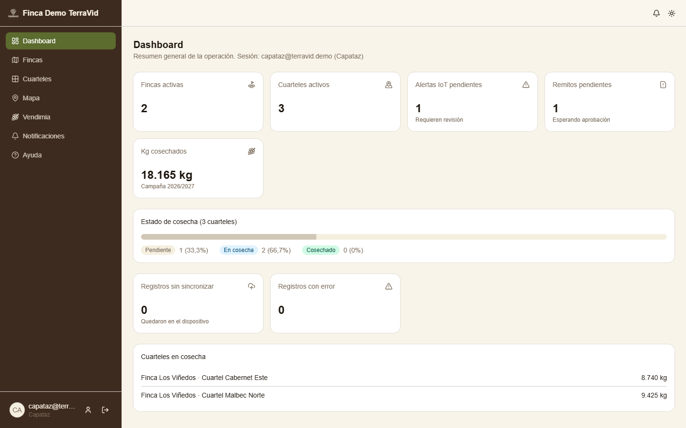 |

### PRU-08 — El backend rechaza acciones restringidas aunque se salteen las pantallas (seguridad · API)

| Campo | Contenido |
|---|---|
| ID de prueba | PRU-08 |
| CU/HU referenciado | HU-05 (alta de usuarios), HU-08 (baja de fincas), HU-07 (log de auditoría) — guards de rol/permiso del backend |
| Pantalla / Reporte | API REST (sin pantalla: simula a un usuario que arma las peticiones a mano) |
| Datos de entrada | Token válido del Capataz. Peticiones: alta de un usuario con rol Propietario; desactivación de la finca Los Viñedos; consulta del log de auditoría. Además, un alta de usuario sin token. |
| Pasos | 1. Obtener un token de Capataz con `POST /api/auth/login`. 2. `POST /api/usuarios`. 3. `PATCH /api/fincas/:id/desactivar`. 4. `GET /api/log-auditoria`. 5. `POST /api/usuarios` sin header `Authorization`. |
| Resultado esperado | 403 Forbidden en las tres acciones con token de Capataz, sin efectos en los datos. 401 Unauthorized sin token. |
| Resultado obtenido | `POST /api/usuarios` → **403**; `PATCH /api/fincas/:id/desactivar` → **403**; `GET /api/log-auditoria` → **403**; `POST /api/usuarios` sin token → **401**. No se creó el usuario ni se desactivó la finca. |
| Estado | **Aprobada** |
| Evidencia | 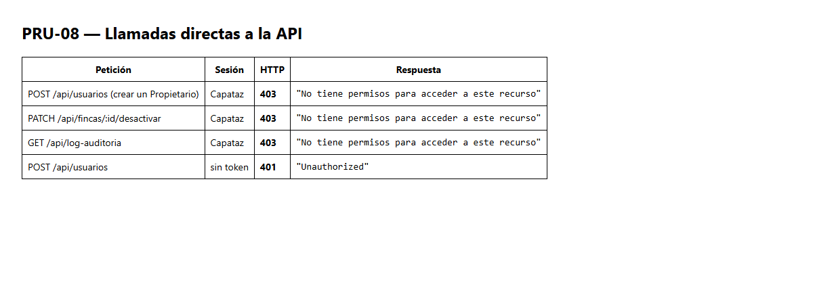 |

### PRU-09 — El Auditor no puede ingresar a la app móvil (seguridad · acceso por cliente)

| Campo | Contenido |
|---|---|
| ID de prueba | PRU-09 |
| CU/HU referenciado | HU-01 — Iniciar sesión (criterio: la app móvil exige el permiso `appMovil`, D-024) |
| Pantalla / Reporte | PAN-01 — Login de la app móvil |
| Datos de entrada | Usuario `auditor@terravid.demo` / `Terravid123!` (credenciales válidas) |
| Pasos | 1. Abrir la app móvil. 2. Ingresar las credenciales del Auditor. 3. Presionar «Iniciar sesión». |
| Resultado esperado | Aunque las credenciales son correctas, el backend responde 403 porque el rol Auditor no tiene el permiso `appMovil`. La app informa que debe usar la versión web y no deja entrar. |
| Resultado obtenido | La app mostró «Tu rol no tiene acceso a la app móvil. Ingresá desde la versión web.» y siguió en el login. La API respondió 403 a `POST /api/auth/login` con `cliente: "movil"`. |
| Estado | **Aprobada** |
| Evidencia | 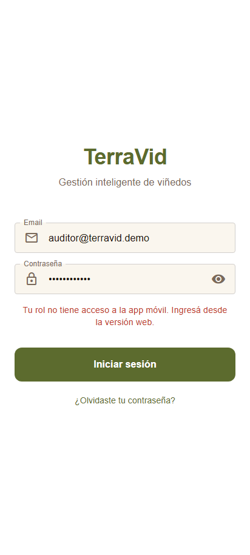 |

---

## 4. Pruebas automatizadas que respaldan las 9 manuales

Además de las 9 pruebas documentadas, en cada commit corren las suites automáticas de los repositorios: CI de GitHub Actions y hook de husky. Resultado de la corrida del 13/10/2026 sobre `main`:

| Repositorio | Herramienta | Resultado | Cobertura de líneas |
|---|---|---|---|
| Backend | Jest (unitarias) | 31 suites · **423/423** ✅ | ver `npm run test:cov:total` (meta 70 %) |
| Backend | Jest + Supertest (integración `test/*.e2e-spec.ts`) y smoke de 185 casos | corren en CI contra PostgreSQL | — |
| Web | Vitest + Testing Library + MSW | 44 archivos · **245/245** ✅ | **83,87 %** (sentencias 82,85 %, ramas 78,43 %) |
| Web | Playwright (`e2e/caminos-por-rol.spec.ts`) | camino feliz por rol contra la API real | — |
| Mobile | Jest | 34 suites · **189/189** ✅ | — |
| Mobile | Maestro (4 flujos en emulador Android 14 y 17) | 4/4 ✅ (última corrida 13/10/2026) | — |

---

## 5. Defectos encontrados y corregidos

| ID | Defecto | Dónde | Severidad | Corrección | Re-ejecución |
|---|---|---|---|---|---|
| DEF-01 | La pantalla **Inteligencia → Recomendaciones** (HU-30) mostraba siempre «El servidor respondió algo que esta versión no entiende». El backend responde `{disponible, diasConDatos, diasMinimos, diasFaltantes, mensaje, recomendaciones}` y cada recomendación trae `evidencia`, pero la Web validaba la respuesta como una lista de recomendaciones con un campo `datos`. Los tests de la Web no lo detectaban porque el mock de MSW repetía la forma vieja. | Web (`src/api/schemas/inteligencia.ts`) | Alta: la funcionalidad no se podía usar | Se alineó el esquema con la respuesta real. Si no hay histórico suficiente, la pantalla muestra cuántos días faltan. Se actualizó el mock con la forma real y se agregó un test del caso sin histórico (W-032). | Re-ejecutada contra la API real: Malbec Norte muestra «Severidad alta · humedad_suelo · La humedad de suelo promedió 25.5 %…» ([captura](img/manual/r-inteligencia_recomendaciones.png)). Vitest de Inteligencia: 4 archivos, 20 tests en verde. |

Lección: un mock escrito a mano puede divergir del backend sin que ningún test lo note. Por eso se suman las pruebas de punta a punta contra la API real (Playwright, W-029) y este tipo de recorrido exploratorio.

## 6. Observaciones registradas durante la ejecución

| # | Observación | Tipo | Tratamiento |
|---|---|---|---|
| OBS-1 | Las labores cargadas con fecha anterior a la vigencia del costo de su tipo de labor quedan en estado `error` con el mensaje «No hay costo vigente para el tipo de labor a la fecha…». El dashboard las cuenta como «Registros con error de sync». | Comportamiento esperado (HU-16: las vigencias no son retroactivas) | Se documenta en el manual de usuario (§ Operaciones, «Los costos no son retroactivos») y en la capacitación: como una vigencia no puede empezar antes de hoy, **los costos y las tarifas se cargan antes de que los capataces empiecen a registrar**. Es un paso del plan de carga inicial (06-plan-implementacion.md §4). Mejora propuesta: permitir que el Propietario cargue la primera vigencia con fecha pasada y listar en la Web las labores con error para reintentarlas (hoy la notificación de error apunta a `/labores?estadoSync=error`, ruta que la Web no tiene). |
| OBS-2 | `npm audit fix` sobre el lockfile de Mobile eliminaba la dependencia `query-string` que necesita `expo-router`: los tests de Jest pasaban pero la exportación web fallaba. | Riesgo de dependencias | El cambio se descartó. Las vulnerabilidades restantes se corrigen con la actualización del SDK de Expo, planificada después de la entrega (ver 03-analisis-estatico.md §5). |
